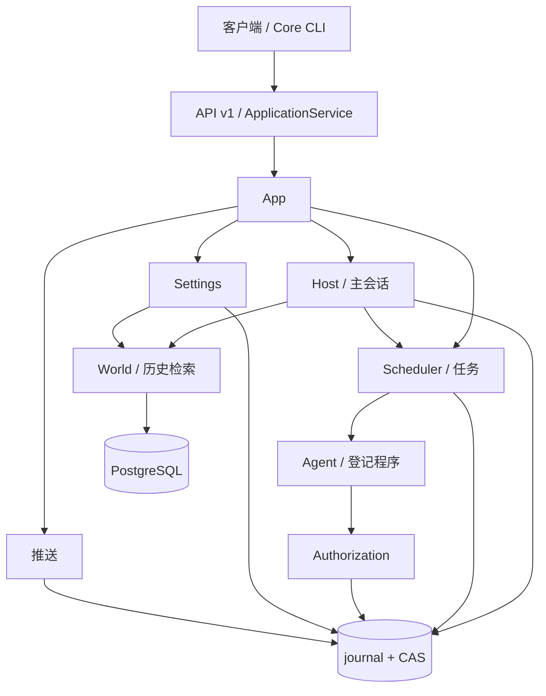

# 架构

Secretary Core 是本机运行的持续个人助理服务。主会话组织记忆、任务与面向 Master 的沟通；Scheduler 推进执行；宿主代码负责授权、持久化和恢复。客户端通过 [API v1](api/v1/README.md) 访问业务状态。

## 模块与依赖

源码位于 `src/pi_secretary/src`；[App.open / pump](../src/pi_secretary/src/app.ts) 是组合和推进入口。

| 模块 | 职责 |
| --- | --- |
| [core-cli / core-client](../src/pi_secretary/src/core-client.ts)、[backend](../src/pi_secretary/src/backend.ts) | 启动、发现、连接和停止后台 Core |
| [api-v1](../src/pi_secretary/src/api-v1.ts)、[application-service](../src/pi_secretary/src/application-service.ts) | HTTP 认证、命令受理、幂等与公开 DTO；`api/` 保存合同及投影 |
| [host](../src/pi_secretary/src/host.ts)、[main-loop](../src/pi_secretary/src/main-loop.ts)、[main-tools](../src/pi_secretary/src/main-tools.ts) | 主会话依赖、输入批次、工具及恢复；context-assembly 与 memory-* 负责上下文和记忆 |
| [scheduler](../src/pi_secretary/src/scheduler.ts)、[task-planning](../src/pi_secretary/src/task-planning.ts)、[task-triggers](../src/pi_secretary/src/task-triggers.ts) | 任务提案、接续、到期工作、前置条件与执行槽 |
| [execution-runner](../src/pi_secretary/src/execution-runner.ts)、[executor-tools](../src/pi_secretary/src/executor-tools.ts)、[effects](../src/pi_secretary/src/effects.ts) | 执行模型、文件与进程作用、结果；execution-recovery 与 retention 负责恢复和归档 |
| [authorization](../src/pi_secretary/src/authorization.ts)、[scopes](../src/pi_secretary/src/scopes.ts) | 操作许可、持久规则、效果裁定、工作根与目录占用 |
| [settings](../src/pi_secretary/src/settings.ts)、[world](../src/pi_secretary/src/world.ts) | 配置切换、结构化事实与 PostgreSQL 回执桥接 |
| [sync-service](../src/pi_secretary/src/sync-service.ts)、[notification-service](../src/pi_secretary/src/notification-service.ts)、[push-service](../src/pi_secretary/src/push-service.ts) | 增量变更、展示/已读与独立推送；wakeups 负责定时输入 |
| [transport](../src/pi_secretary/src/transport.ts)、[store](../src/pi_secretary/src/store.ts) | 保存模型请求/响应，提交业务状态与对象引用 |

Pi Agent 和模型适配依赖固定版本，来源见 [UPSTREAM.json](../src/UPSTREAM.json)。公开 API schema 与内部持久 schema 分别维护；生成文件、测试与历史资料的入口见[文档目录](README.md)。

## 进程与并发

每个数据目录由一个持锁 Core writer 管理，保存唯一主会话。Host 串行处理输入批次；Scheduler 默认允许两个执行者，`SECRETARY_MAX_WORKERS` 调整上限。同一 DIRECTORY Scope 串行占用绑定根；NONE 与未选 Scope 的任务使用各自 `workspaces/<task_id>/work`。

Core 启动依次打开 Store、恢复 Authorization 和 Scheduler，再构造 Host、Settings 并预热读索引。API 每 300 ms 调用 pump，推进推送、检索、World、设置、任务、反馈、唤醒和主会话。模块各自管理进行中的工作；停止时关闭模型、执行者、数据库连接和 writer。

shell/program 由 [process-control](../src/pi_secretary/src/process-control.ts) 启动 Python wrapper：先报告进程身份，持久保存后再接收启动帧。效果结果和进程停止分别保存。bash 以本机用户权限在绑定目录执行；文件 read/write 与产物读取使用根内路径校验。登记程序校验入口 revision 与 SHA-256，以 stdin/stdout 交换 ProgramInvocation/ProgramResult。

## 数据与提交

`record_type + id` 标识记录，revision 控制更新，ObjectRef 以 SHA-256、字节数和媒体类型引用原件。Session/Input 保存主会话输入，TaskPlan/Execution/TaskResult 保存任务各轮，Consciousness/MemoryExtractionJob 保存工作记忆及来源，Operation 保存一次外部作用。字段见[生成参考](data/README.md)。

Store 先写 CAS 对象，再校验并追加哈希链 journal 事务，收到 fsync ACK 后安装内存状态和索引。Worker 经匿名管道连接持锁 Python helper；请求 ID、sequence 和 digest 绑定追加确认。提交与重放检查引用文件及长度，读取正文时验证完整哈希。新 Context 使用有序消息引用清单，`Store.read` 同时支持清单和旧消息数组。

[状态目录](../src/state_machine/catalog.json) 保留 Execution、Operation、Input、Authorization：Store 在提交与重放时检查前三者的状态变化，Authorization 按事件推进；其余记录由领域模块管理。World 在 PostgreSQL 事务中保存事实、回执和 outbox，再按回执导入 journal。检索、timeline 和活动索引均可从权威记录重建。具体约束见[系统不变量](invariants.md)。

## 当前限制

- Store 启动完整重放 journal，历史帧与日志常驻内存，尚无快照加速与历史回收。
- Context 已共享消息对象，模型请求及供应商 payload 仍保存完整快照，长循环总存储量可能平方增长。
- shell/program 使用本机用户权限；Scope 提供目录绑定、调度及文件工具约束。
