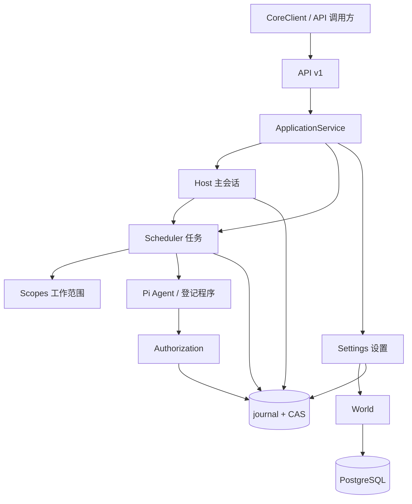

# 架构

Secretary 由独立 Core 进程承载。API v1 接收本机 owner 的命令，ApplicationService 组织领域调用，Host 处理主会话，Scheduler 推进任务，Store 保存本地状态。World 使用可选的 PostgreSQL 数据库。

## 模块

以下源码位于 `src/pi_secretary/src`。

| 模块 | 职责 |
| --- | --- |
| core-cli / core-client / backend | 启动、发现、附着、状态查询和停止 Core |
| api-v1 / application-service / api | HTTP 认证、命令幂等、异步受理、分页和公开 DTO |
| app | 组合模块，推进 pump，协调关闭 |
| host / main-loop / main-tools | Host 组装依赖并持有运行状态；主循环处理输入和恢复回执，工具模块定义主会话工具 |
| context-assembly / memory-maintenance / memory-summary | 上下文投影与裁剪、Settings 上下文装配、记忆整理触发与摘要提交 |
| scheduler / task-planning / task-triggers | Scheduler 持有执行槽；规划模块处理提案与接续，触发模块领取到期工作并检查前提 |
| execution-runner / executor-tools / effects | 执行模型、任务工具、shell/文件/登记程序副作用与结果保存 |
| execution-recovery / retention / scopes | 进程恢复与未知结果收束、归档留存、冻结工作根与目录占用 |
| authorization | 准备 Operation、匹配规则、审批、派发及效果裁定 |
| process-control / process-runner.py | shell/program 启动门控、身份登记与进程组清理 |
| model / transport / model-retry / budget | 双角色模型、持久请求、有界重试、请求容量 |
| context / memory / summary / settings-memory | 上下文、工作摘要、承诺来源与分段整理 |
| settings / settings-payload / world | 设置应用、World 批次、数据库回执和审计导出 |
| store / store-lock / lock.py | schema 校验、对象哈希、事务日志和目录 writer 锁 |
| preview / activity / activity-history / timeline | 临时模型预览、活动和可重建读索引 |

## 生命周期与并发

一个数据目录对应一个持锁 Core writer、一个主会话。Host 串行处理输入批次；Scheduler 默认最多两个执行者，可由 `SECRETARY_MAX_WORKERS` 配置。同一 Task 的执行依次推进，同一 DIRECTORY Scope 也依次占用目录；NONE 范围中的不同任务使用各自目录并行运行。

Core 启动时打开 Store，恢复授权和受控进程，分类恢复 Execution，再构造 Host、Settings 并预热读索引。API 每 300 ms 推进一次 App pump；各模块用当前工作状态协调异步推进。显式停止关闭模型循环、执行者、数据库连接及 writer 锁。

## 模型与执行

主会话使用六个已注册工具组织工作；执行 Agent 使用文件、shell、工作决定和结果提交工具。登记程序以 Node 子进程运行。DIRECTORY 执行采用创建时冻结的项目根，NONE 和无 Scope 执行采用任务目录。文件写入、shell、程序和模型提出的 World 修改由 Authorization 管理。

shell/program 的 wrapper 先报告身份，Core 持久化后发送启动帧。启动前取消产生 NOT_APPLIED；命令结果来自结果帧，缺帧时记录 UNKNOWN。恢复过程中，效果裁定与进程停止分别记录，目录槽在运行结束且进程确认停止后释放。

## 读模型与存储

内部记录由[运行 schema](../src/contracts/contracts.schema.json)描述，HTTP 读写由[API schema](api/v1/schema.json)描述。公开投影使用资源 ID、内容版本和字符串 revision；任务工作文件保留在工作根，发布的产物保存为 CAS 对象。

timeline 使用消息/事件 ID、排序锚点和 generation 分页。`streaming=true` 加入内存预览，`thinking=true` 加入供应商提供的可见思考。持久响应写入 ModelCall 后交给执行循环。GET 读取状态，用户访问执行通过 viewed 命令记录。

World 的事务回执经 outbox 导入 journal。当前 API 使用请求查询和分页读取；可靠 ChangeFeed 属于 #9。SwiftUI、通知呈现回执、设备和上传能力见 [README 路线](../README.md#开发路线)。

## 实现依赖

Pi 版本和子模块提交固定在 [UPSTREAM.json](../src/UPSTREAM.json)。Secretary 使用其中的 Agent、工具及执行环境，模型传输依赖与其版本匹配。旧 Web/TUI 文件保留在源码目录，现行服务入口为 Core API v1，客户端清理由 #10 承接。
