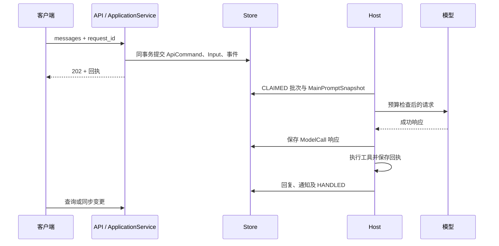
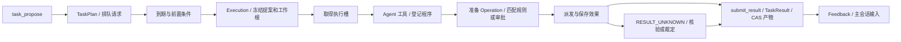
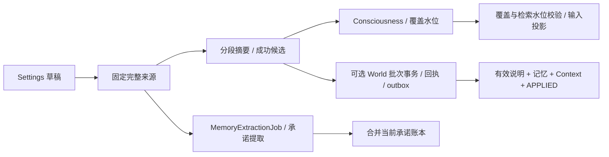
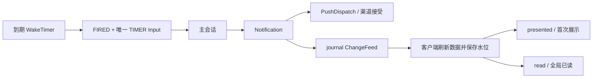

# 数据流

## 输入到回复

[ApplicationService](../src/pi_secretary/src/application-service.ts) 将受理与首次领域变更绑定。[主循环](../src/pi_secretary/src/main-loop.ts) 固定本轮说明、工具和 Scope 快照，经 [durableStream](../src/pi_secretary/src/transport.ts) 保存成功响应后才交给 Agent 执行工具。恢复复用已有成功响应与工具回执；临时预览按 call_id 与最终消息关联。`MasterInteract` 创建通知，普通最终回复与通知各自保留在历史中。

## 任务从提案到结果

[task-planning](../src/pi_secretary/src/task-planning.ts) 保存完整目标、约束、验收项和材料；[task-triggers](../src/pi_secretary/src/task-triggers.ts) 支持 IMMEDIATE、AT、INTERVAL。[执行器](../src/pi_secretary/src/executor-tools.ts) 提供 read、write、bash、request_decision、submit_result；等待审批或工作回答时暂停。write 默认在绑定根内放行，DIRECTORY 可设 `default_write=ask`；简单只读命令由 [shell-policy](../src/pi_secretary/src/shell-policy.ts) 解析为固定 argv，其他 shell 走授权。批准并记住在同一事务保存授权与规则，派发前重新检查规则和资源。

`reuse_task_id + parent_execution_id` 在同一任务创建即时接续，parent 须为最新、已结束、仍 HOT 的执行。goal 是本轮完整目标；省略/null 的约束、验收、期限与执行器继承，显式数组替换原字段，Scope 沿用任务；接续不带 at/interval。新 Execution 固定新提案及当时工作根，旧记录保留。结果中的逐项评估由执行者提交，`verified_by=NOT_VERIFIED`；产物保存为固定 CAS 版本。执行默认 HOT 留存 48 小时，viewed 可续留，满足条件后由 [retention](../src/pi_secretary/src/retention.ts) 归档。

## 记忆维护与设置

[记忆维护](../src/pi_secretary/src/memory-maintenance.ts) 独立提交摘要和提取进度，失败分段按保存的次数补试。[Settings](../src/pi_secretary/src/settings.ts) 固定草稿与来源、暂停主会话和新任务领取，先完成摘要与容量检查，再提交 World 批次并桥接回执，最后原子切换本地配置；只改说明时直接重建 Context。期间新输入继续排队，已运行任务可完成。COMMITTING/REBUILDING 重启按数据库回执对账，FAILED 的人工批次可恢复草稿，BLOCKED 继续查询已提交结果。输入退出和来源规则见[记忆与提示词](memory-and-prompts.md)。

## 同步、提醒与通知

[wakeups](../src/pi_secretary/src/wakeups.ts) 在 pump 中交付到期定时器，启动后补交停机期间到期项；TIMER 保留来源和迟到时间，由主会话判断是否通知。[SyncService](../src/pi_secretary/src/sync-service.ts) 按 journal 事务提供持久游标，客户端先取水位、加载资源，再追赶变更并连接 SSE；record 更新和 invalidate 刷新共同处理聚合视图。[通知服务](../src/pi_secretary/src/notification-service.ts) 分别保存每客户端首次展示和全局首次已读；[推送 worker](../src/pi_secretary/src/push-service.ts) 独立处理渠道发送、免打扰和重试。客户端协议见 [API v1](api/v1/README.md)。

## 当前限制

- 定时唤醒依赖 Core 运行，整机睡眠期间到期项在恢复后交付。
- 推送采用有界重试并可能重复发送，渠道接受与客户端展示分别记录。
