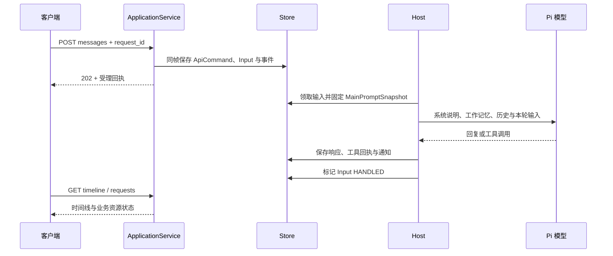

# 数据流

## 一轮对话

主会话工具可以提交任务、查询任务、读取记忆、提出 World 修改或创建通知。工具反馈和 Master 输入保留各自的来源类型。时间线按 `streaming`、`thinking` 开关加入内存预览；最终响应保存到 Store。

## 一次任务执行

`task_propose` 保存完整目标、约束、验收项和材料，Scheduler 将提案固定为 `proposal_ref`。到期后创建 Execution，冻结 Scope 与工作目录，检查前置条件并取得执行名额。DIRECTORY 中同一范围串行；NONE 中各任务使用自己的目录，可以并行。

Agent 调用 read/write/bash，或 Scheduler 调用已登记程序。需要许可的 Operation 进入 WAIT_AUTH；批准后按绑定参数派发并保存结果。shell 和程序先由 wrapper 就绪、持久记录身份，再接收启动指令。结果缺失时记录 RESULT_UNKNOWN，后续核验或人工裁定与进程停止确认共同决定收束时机。

`submit_result` 提交逐项验收评估、局限和产物。Scheduler 将文件保存为不可变 CAS 对象，生成 TaskResult 和 Feedback；Host 将反馈作为新输入，主会话读取结果并向 Master 汇报。产物下载按 artifact ID 读取固定版本。

## 同任务接续

`reuse_task_id + parent_execution_id` 指向同一任务最新、已结束且仍为 HOT 的执行。受理事务同时保存新要求、待执行请求和 parent 关联；tick 消费请求后创建新 Execution。新执行沿用任务 Scope，使用该范围当前配置生成新的目录绑定。

重复 request ID 返回原回执。取消未派发请求会移出队列；已派发请求转入执行取消流程。任务基线、每轮要求和每轮结果分别保存。

## 记忆与设置

普通维护从固定来源整理 Consciousness，并更新覆盖水位；承诺提取由独立 MemoryExtractionJob 跟踪来源和分段，失败来源按退避计划补提。已完成的工作记忆更新继续有效。

Settings 应用先固定全部未整理来源，完成摘要与新 context 容量检查，再提交 World 批次事务。PostgreSQL 保存批次回执和 audit_outbox；Core 将回执桥接到 journal，随后提交有效说明、Consciousness、新 Context 和 APPLIED 状态。期间到达的输入继续排队。

## API 命令

短命令在同一 journal 帧中保存受理与首个领域变更。长命令先保存 QUEUED，执行前转 RUNNING，结束为 COMPLETED；中断的 RUNNING 在恢复时转 UNKNOWN。客户端用原 request ID 查询回执，再读取关联领域资源。记忆提取 retry 属于短命令，实际补提由后续维护推进。

实现入口：[ApplicationService](../src/pi_secretary/src/application-service.ts)、[Host](../src/pi_secretary/src/host.ts)、[Scheduler](../src/pi_secretary/src/scheduler.ts)、[Settings](../src/pi_secretary/src/settings.ts)。
