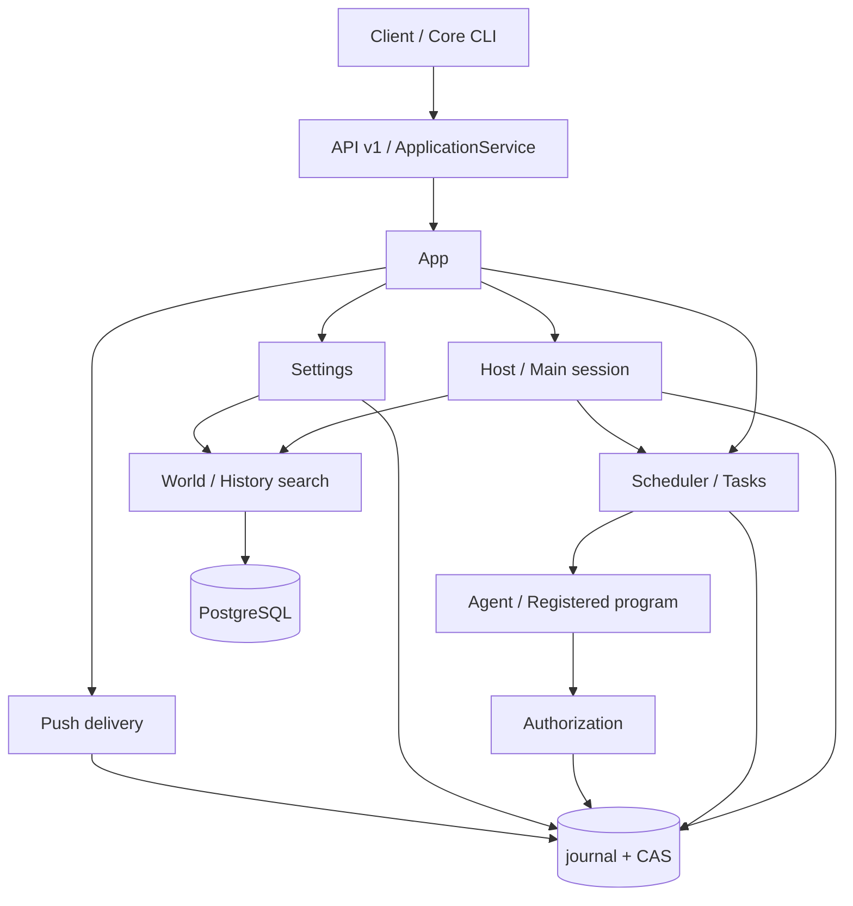

# Architecture

[English](architecture.md) | [日本語](../ja/architecture.md) | [Français](../fr/architecture.md) | [中文](../architecture.md)

<!-- Generated by npm run docs:localize; edit docs/i18n/translations.json. -->

Secretary Core is a persistent personal assistant service running locally. The main session organizes memory, tasks, and communication with Master; Scheduler advances execution; host code handles authorization, persistence, and recovery. Clients access domain state through [API v1](api/v1/README.md).

## Modules and dependencies

Source lives in `src/pi_secretary/src`; [App.open / pump](../../src/pi_secretary/src/app.ts) is the entry point for composition and progress.

| Module | Responsibility |
| --- | --- |
| [core-cli / core-client](../../src/pi_secretary/src/core-client.ts), [backend](../../src/pi_secretary/src/backend.ts) | Start, discover, connect to, and stop the background Core |
| [api-v1](../../src/pi_secretary/src/api-v1.ts), [application-service](../../src/pi_secretary/src/application-service.ts) | HTTP authentication, command admission, idempotency, and public DTOs; `api/` holds contracts and projections |
| [host](../../src/pi_secretary/src/host.ts), [main-loop](../../src/pi_secretary/src/main-loop.ts), [main-tools](../../src/pi_secretary/src/main-tools.ts) | Main-session dependencies, input batches, tools, and recovery; context-assembly and memory-* handle context and memory |
| [scheduler](../../src/pi_secretary/src/scheduler.ts), [task-planning](../../src/pi_secretary/src/task-planning.ts), [task-triggers](../../src/pi_secretary/src/task-triggers.ts) | Task proposals, continuations, due work, preconditions, and execution slots |
| [execution-runner](../../src/pi_secretary/src/execution-runner.ts), [executor-tools](../../src/pi_secretary/src/executor-tools.ts), [effects](../../src/pi_secretary/src/effects.ts) | Execution models, file and process effects, results; execution-recovery and retention handle recovery and archiving |
| [authorization](../../src/pi_secretary/src/authorization.ts), [scopes](../../src/pi_secretary/src/scopes.ts) | Operation permissions, persistent rules, effect resolution, workspace roots, and directory occupancy |
| [settings](../../src/pi_secretary/src/settings.ts), [world](../../src/pi_secretary/src/world.ts) | Configuration switching, structured facts, and PostgreSQL receipt bridging |
| [sync-service](../../src/pi_secretary/src/sync-service.ts), [notification-service](../../src/pi_secretary/src/notification-service.ts), [push-service](../../src/pi_secretary/src/push-service.ts) | Incremental changes, presentation/read tracking, and independent push delivery; wakeups handles scheduled inputs |
| [transport](../../src/pi_secretary/src/transport.ts), [store](../../src/pi_secretary/src/store.ts) | Persist model requests/responses; commit domain state and object references |

Pi Agent and model adapters use pinned dependencies; see [UPSTREAM.json](../../src/UPSTREAM.json) for provenance. Public API schemas and internal persistence schemas are maintained separately. The [documentation index](README.md) links generated files, tests, and historical material.

## Processes and concurrency

One lock-owning Core writer manages each data directory and its single main session. Host processes input batches serially. Scheduler allows two executors by default; `SECRETARY_MAX_WORKERS` changes the limit. Executions in the same DIRECTORY Scope occupy the bound root serially. Tasks with NONE or no Scope use their own `workspaces/<task_id>/work`.

Startup opens Store, recovers Authorization and Scheduler, then constructs Host and Settings and warms read indexes. The API calls pump every 300 ms to advance push delivery, search, World, settings, tasks, feedback, wakeups, and the main session. Each module manages its in-flight work. Shutdown closes models, executors, database connections, and the writer.

[process-control](../../src/pi_secretary/src/process-control.ts) starts shell/program through a Python wrapper: it reports process identity first and accepts the start frame only after that identity is persisted. Effect results and process termination are recorded separately. bash runs as the local user in the bound directory; file read/write and artifact reads validate paths within the root. Registered programs verify entrypoint revision and SHA-256 and exchange ProgramInvocation/ProgramResult over stdin/stdout.

## Data and commits

`record_type + id` identifies a record; revision controls updates; ObjectRef references original content by SHA-256, byte length, and media type. Session/Input hold main-session inputs; TaskPlan/Execution/TaskResult hold task rounds; Consciousness/MemoryExtractionJob hold working memory and provenance; Operation records one external effect. See the [generated reference](data/README.md) for fields.

Store writes CAS objects first, then validates and appends a hash-chained journal transaction. It installs in-memory state and indexes after receiving the fsync ACK. A worker connects to the lock-owning Python helper through anonymous pipes; request ID, sequence, and digest bind the append acknowledgment. Commit and replay check referenced files and lengths; content reads verify the full hash. New Context objects use ordered message-reference manifests; `Store.read` supports both manifests and legacy message arrays.

The [state catalog](../../src/state_machine/catalog.json) retains Execution, Operation, Input, and Authorization. Store checks transitions for the first three during commit and replay; Authorization advances by events. Domain modules manage other records. World commits facts, receipts, and the outbox in a PostgreSQL transaction, then imports them into the journal using receipts. Search, timeline, and activity indexes can all be rebuilt from authoritative records. See [system invariants](invariants.md) for constraints.

## Current limitations

- Store replays the entire journal at startup and keeps historical frames and logs in memory. Snapshot acceleration and history reclamation are not yet implemented.
- Context shares message objects, but model requests and provider payloads still retain full snapshots; total storage may grow quadratically in long loops.
- shell/program runs with local-user privileges; Scope supplies directory binding, scheduling, and file-tool constraints.
