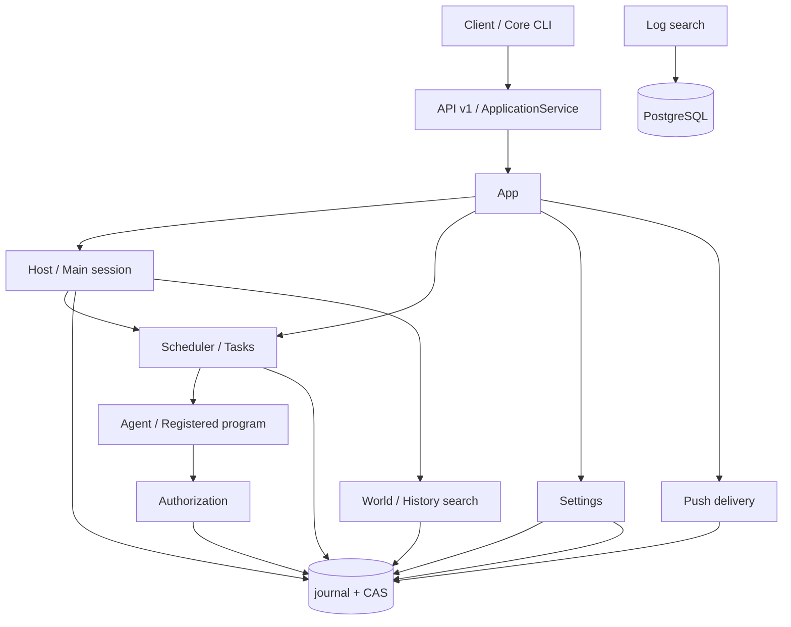

# Architecture

[English](architecture.md) | [日本語](../ja/architecture.md) | [Français](../fr/architecture.md) | [中文](../architecture.md)

<!-- Generated by npm run docs:localize; edit docs/i18n/translations.json. -->

Secretary Core is a persistent personal assistant service running locally. The main session organizes memory, tasks, and communication with Master; Scheduler advances execution; host code handles authorization, persistence, and recovery. Clients access domain state through [API v1](api/v1/README.md).

## Modules and dependencies

Source lives in `src/pi_secretary/src`; [App.open / pump](../../src/pi_secretary/src/app.ts) is the entry point for composition and progress.

| Module | Responsibility |
| --- | --- |
| [core-cli / core-client](../../src/pi_secretary/src/core-client.ts), [backend](../../src/pi_secretary/src/backend.ts) | Start, discover, connect to, and stop the background Core |
| [api-v1](../../src/pi_secretary/src/api-v1.ts), [application-service](../../src/pi_secretary/src/application-service.ts) | HTTP authentication, command admission, idempotency, and public DTOs; `api/` holds contracts and projections |
| [host](../../src/pi_secretary/src/host.ts), [main-loop](../../src/pi_secretary/src/main-loop.ts), [main-tools](../../src/pi_secretary/src/main-tools.ts) | Main-session dependencies, input batches, tools, and recovery; context-assembly and memory-* handle context and memory |
| [scheduler](../../src/pi_secretary/src/scheduler.ts), [task-planning](../../src/pi_secretary/src/task-planning.ts), [task-triggers](../../src/pi_secretary/src/task-triggers.ts) | Task proposals, continuations, due work, preconditions, and execution slots |
| [execution-runner](../../src/pi_secretary/src/execution-runner.ts), [executor-tools](../../src/pi_secretary/src/executor-tools.ts), [effects](../../src/pi_secretary/src/effects.ts) | Execution models, file and process effects, results; execution-recovery and retention handle recovery and archiving |
| [authorization](../../src/pi_secretary/src/authorization.ts), [scopes](../../src/pi_secretary/src/scopes.ts) | Operation permissions, persistent rules, effect resolution, workspace roots, and directory occupancy |
| [settings](../../src/pi_secretary/src/settings.ts), [world](../../src/pi_secretary/src/world.ts) | Settings activation; Store-backed World facts and independent PostgreSQL log search |
| [sync-service](../../src/pi_secretary/src/sync-service.ts), [notification-service](../../src/pi_secretary/src/notification-service.ts), [push-service](../../src/pi_secretary/src/push-service.ts) | Incremental changes, presentation/read tracking, and independent push delivery; wakeups handles scheduled inputs |
| [transport](../../src/pi_secretary/src/transport.ts), [store](../../src/pi_secretary/src/store.ts) | Persist model requests/responses; commit domain state and object references |

Pi Agent and model adapters use pinned dependencies; see [UPSTREAM.json](../../src/UPSTREAM.json) for provenance. Public API schemas and internal persistence schemas are maintained separately. The [documentation index](README.md) links generated files, tests, and historical material.

## Processes and concurrency

One lock-owning Core writer manages each data directory and its single main session. Host processes input batches serially. Scheduler allows two executors by default; `SECRETARY_MAX_WORKERS` changes the limit. Executions in the same DIRECTORY Scope occupy the bound root serially. Tasks with NONE or no Scope use their own `workspaces/<task_id>/work`.

Core opens Store, checks upgrade readiness and establishes identity/profile, then imports or seeds World genesis before recovering Authorization/Scheduler and constructing Host/Settings. It initializes the independent log-search schema and warms read indexes. The API pumps every 300 ms to advance pushes, search, World, Settings, tasks, feedback, wakeups and Main. Each module manages its in-flight work; shutdown closes models, executors, database connections and the writer.

[process-control](../../src/pi_secretary/src/process-control.ts) starts shell/program through a Python wrapper: it reports process identity first and accepts the start frame only after that identity is persisted. Effect results and process termination are recorded separately. bash runs as the local user in the bound directory; file read/write and artifact reads validate paths within the root. Registered programs verify entrypoint revision and SHA-256 and exchange ProgramInvocation/ProgramResult over stdin/stdout.

## Data and commits

`record_type + id` identifies a record; revision controls updates; ObjectRef references original content by SHA-256, byte length, and media type. Session/Input hold main-session inputs; TaskPlan/Execution/TaskResult hold task rounds; Consciousness/MemoryExtractionJob hold working memory and provenance; Operation records one external effect. See the [generated reference](data/README.md) for fields.

Store writes CAS objects first, then validates and appends a hash-chained journal transaction. It installs in-memory state and indexes after receiving the fsync ACK. A worker connects to the lock-owning Python helper through anonymous pipes; request ID, sequence, and digest bind the append acknowledgment. Commit and replay check referenced files and lengths; content reads verify the full hash. New Context objects use ordered message-reference manifests; `Store.read` supports both manifests and legacy message arrays.

[State catalog](../../src/state_machine/catalog.json) defines Execution, Operation, Input and Authorization. Store validates the first three during commit/replay; Authorization advances by events and other records by domain modules. World commits records, grants and results atomically to the journal; legacy SQL is imported read-only once. Search, timeline and activity indexes can be rebuilt from authoritative records. See [System invariants](invariants.md).

## Current limitations

- Store replays the entire journal at startup and keeps historical frames and logs in memory. Snapshot acceleration and history reclamation are not yet implemented.
- Context shares message objects, but model requests and provider payloads still retain full snapshots; total storage may grow quadratically in long loops.
- shell/program runs with local-user privileges; Scope supplies directory binding, scheduling, and file-tool constraints.

## Data retention and retirement boundaries

Execution `retention_state=RETIRED` is separate from terminal `state` and is not permission to delete data. [retention](../../src/pi_secretary/src/retention.ts) requires a terminal execution, no pending requests, unknown operations or pending follow-ups, all Feedback `HANDLED`/`SUPPRESSED`, and elapsed time since `max(ended_at, last_activity_at)` reaching `retire_after_seconds` (172800 seconds at creation). It reads event and result-detail CAS bytes, saves ArchiveManifest and marks retirement; it deletes no journal, CAS or workspace. Lists, details and Task browsing do not renew retention; explicit `viewed` resets the period only before retirement. Retired detail returns identity and manifest only, artifacts are `archived`, and continuation rejects this parent (`PARENT_NOT_RESUMABLE`).

Backup and recovery must cover the Core directory, its PostgreSQL database, client drafts/recovery material and external Scope roots together. A CAS artifact snapshot and the current workspace file are distinct and cannot replace each other; mixing a database and journal from different points is not a complete recovery. See [operations](operations.md#backup-and-upgrades) and the retention regression in [runtime tests](../../test_case/offline/runtime/runtime.test.ts).
