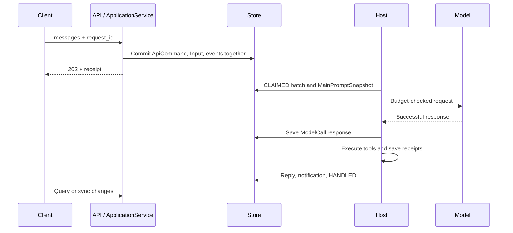
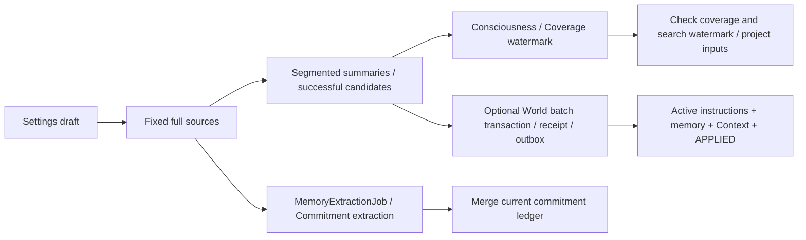
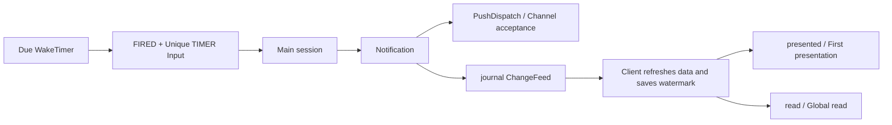

# Data flow

[English](data-flow.md) | [日本語](../ja/data-flow.md) | [Français](../fr/data-flow.md) | [中文](../data-flow.md)

<!-- Generated by npm run docs:localize; edit docs/i18n/translations.json. -->

## From input to reply

[ApplicationService](../../src/pi_secretary/src/application-service.ts) binds admission to the first domain change. The [main loop](../../src/pi_secretary/src/main-loop.ts) freezes the round’s instructions, tools, and Scope snapshot; [durableStream](../../src/pi_secretary/src/transport.ts) persists the successful response before handing it to Agent for tool execution. Recovery reuses saved successful responses and tool receipts; transient previews are linked to final messages by call_id. `MasterInteract` creates notifications; ordinary final replies and notifications are retained separately in history.

## From task proposal to result

```mermaid
flowchart LR
  Proposal[task_propose] --> Plan[TaskPlan / Queued request]
  Plan --> Due[Due work and preconditions]
  Due --> Execution[Execution / Frozen proposal and workspace root]
  Execution --> Slot[Acquire execution slot]
  Slot --> Tool[Agent tools / Registered program]
  Tool --> Auth[Prepare Operation / match rule or request approval]
  Auth --> Effect[Dispatch and persist effects]
  Effect --> Result[submit_result / TaskResult / CAS artifacts]
  Effect --> Unknown[RESULT_UNKNOWN / Verify or resolve]
  Unknown --> Result
  Result --> Feedback[Feedback / Main-session input]
```

[task-planning](../../src/pi_secretary/src/task-planning.ts) saves the full goal, constraints, acceptance criteria, and materials; [task-triggers](../../src/pi_secretary/src/task-triggers.ts) supports IMMEDIATE, AT, and INTERVAL. [Executor tools](../../src/pi_secretary/src/executor-tools.ts) are read, write, bash, request_decision, and submit_result; execution pauses while awaiting approval or a work-related answer. write is allowed within the bound root by default; DIRECTORY supports `default_write=ask`. [shell-policy](../../src/pi_secretary/src/shell-policy.ts) parses simple read-only commands into fixed argv; other shell commands require authorization. Approve-and-remember saves approval and a rule in one transaction; rules and resources are rechecked before dispatch.

`reuse_task_id + parent_execution_id` creates an immediate continuation within the same task. The parent must be the latest, finished, unarchived execution. goal is the full goal for this round; omitted/null constraints, acceptance criteria, deadline, and executor are inherited; explicit arrays replace those fields. Scope stays with the task; continuations have no at/interval. Each new Execution freezes its proposal and current workspace root; old records remain. Executors submit per-item assessments with `verified_by=NOT_VERIFIED`; artifacts are fixed CAS versions. Executions default to 48 hours of HOT retention, extendable through viewed, then [retention](../../src/pi_secretary/src/retention.ts) archives eligible executions.

## Memory maintenance and settings

[Memory maintenance](../../src/pi_secretary/src/memory-maintenance.ts) commits summaries and extraction progress independently, retrying failed segments using persisted attempt counts. [Settings](../../src/pi_secretary/src/settings.ts) freezes drafts and sources and pauses the main session and new task claims. It completes summary and capacity checks, commits the World batch and bridges its receipt, then switches local configuration atomically. Instruction-only changes rebuild Context directly. New inputs queue while running tasks may finish. Restarts in COMMITTING/REBUILDING reconcile database receipts; FAILED manual batches can restore their drafts, while BLOCKED continues querying committed results. See [memory and prompts](memory-and-prompts.md) for input removal and provenance rules.

## Sync, reminders, and notifications

[wakeups](../../src/pi_secretary/src/wakeups.ts) delivers due timers during pump and catches up timers that expired while stopped. TIMER retains provenance and lateness; the main session decides whether to notify. [SyncService](../../src/pi_secretary/src/sync-service.ts) supplies durable cursors over journal transactions. Clients obtain a watermark, load resources, catch up changes, then connect SSE; record updates and invalidate refreshes jointly maintain aggregate views. The [notification service](../../src/pi_secretary/src/notification-service.ts) records each client’s first presentation and the global first read independently. The [push worker](../../src/pi_secretary/src/push-service.ts) handles channel delivery, quiet hours, and retries independently. See [API v1](api/v1/README.md) for the client protocol.

## Current limitations

- Scheduled wakeups require Core to run; timers expiring during system sleep are delivered on resume.
- Push delivery uses bounded retries and may duplicate messages; channel acceptance and client presentation are recorded separately.
