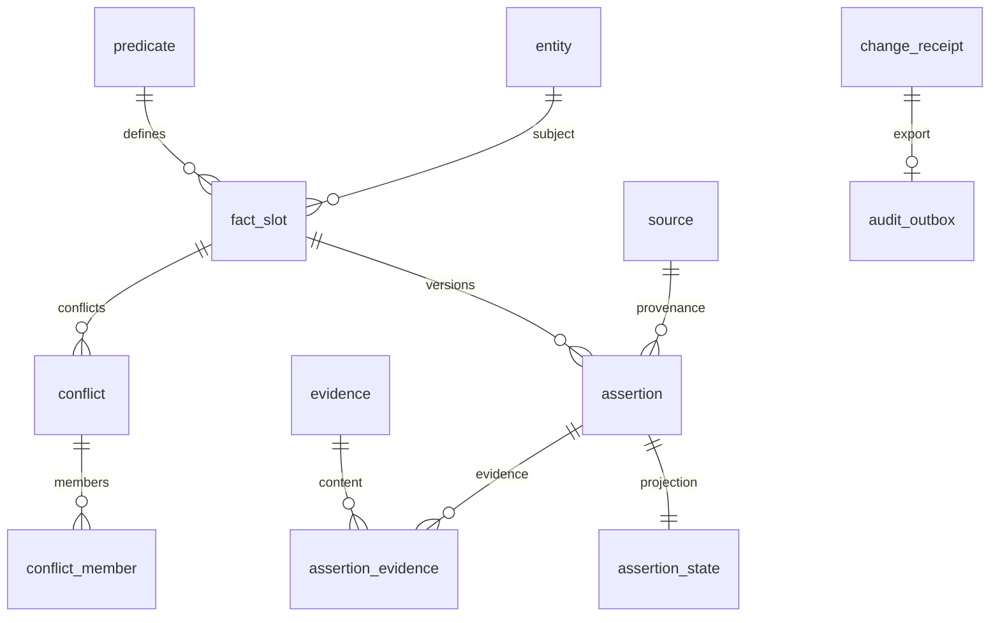

# PostgreSQL schema

[English](database.md) | [日本語](../ja/database.md) | [Français](../fr/database.md) | [中文](../database.md)

<!-- Generated by npm run docs:localize; edit docs/i18n/translations.json. -->

World Model authoritative facts use schema `wm`; rebuildable history-text indexes use `mem`. Session, Task, authorization rules, Context, and Consciousness live in the local journal, not PostgreSQL tables.

Authoritative SQL: [001_world_model.sql](../../src/schema/001_world_model.sql), [002_predicates.sql](../../src/schema/002_predicates.sql), [003_settings.sql](../../src/schema/003_settings.sql), [004_memory_search.sql](../../src/schema/004_memory_search.sql), [queries.sql](../../src/schema/queries.sql). Runtime repository: [world.ts](../../src/pi_secretary/src/world.ts).

## Migrations and transactions

World.migrate serializes migrations using an advisory lock. If schema_version is absent, it installs the baseline, applies predicate seeds and records version 2, then applies version 3 for settings_batch_receipt and version 4 for mem/aliases. Baseline/seed have their own transactions; migrate rolls back and releases the lock on failure. The owner explicitly POSTs /api/v1/admin/world/migrate and confirms through the request receipt. Core CLI does not handle --migrate.

Changes pass through the Settings coordinator for summary and context preflight. Authenticated local-owner Settings API calls record explicit application evidence; model proposals still require authorization. Database transactions check entities, predicates, and slot revisions and commit the full batch atomically with settings_batch_receipt. change_id/request_id/request_hash support deduplication and conflict detection. Assertions, state projections, conflicts, evidence, change_receipt, and audit_outbox commit together; JSONL audit export is a separate recoverable bridge.

## Relationships



## Table fields and constraints

The definitions below are generated directly from current SQL, including defaults, foreign keys, CHECK, UNIQUE, and deferred constraints.

### wm.schema_version

```sql
version integer PRIMARY KEY CHECK (version > 0),
    installed_at timestamptz NOT NULL DEFAULT now()
```

### wm.entity

```sql
entity_id uuid PRIMARY KEY,
    kind text NOT NULL CHECK (kind IN ('PERSON','ORGANIZATION','PROJECT','DEVICE','SERVICE','RESOURCE','GOAL')),
    display_name text NOT NULL CHECK (length(display_name)>0),
    external_key text UNIQUE,
    revision bigint NOT NULL DEFAULT 1 CHECK (revision>0),
    retired_at timestamptz,
    created_at timestamptz NOT NULL DEFAULT now(),
    updated_at timestamptz NOT NULL DEFAULT now()
```

### wm.source

```sql
source_id uuid PRIMARY KEY,
    kind text NOT NULL CHECK (kind IN ('MASTER','OBSERVATION','TASK_REPORT','MODEL_INFERENCE')),
    source_key text NOT NULL UNIQUE,
    description text NOT NULL,
    retired_at timestamptz
```

### wm.predicate

```sql
predicate_key text PRIMARY KEY CHECK (predicate_key ~ '^[a-z][a-z0-9_.]+$'),
    description text NOT NULL,
    subject_kinds text[] NOT NULL CHECK (cardinality(subject_kinds)>0),
    value_type text NOT NULL CHECK (value_type IN ('STRING','NUMBER','BOOLEAN','OBJECT','ARRAY','ENTITY')),
    cardinality text NOT NULL CHECK (cardinality IN ('SINGLE','MULTI')),
    unit text,
    value_schema jsonb NOT NULL CHECK (jsonb_typeof(value_schema)='object'),
    definition_revision bigint NOT NULL DEFAULT 1 CHECK (definition_revision>0)
```

### wm.fact_slot

```sql
slot_id uuid PRIMARY KEY,
    subject_id uuid NOT NULL REFERENCES wm.entity(entity_id),
    predicate_key text NOT NULL REFERENCES wm.predicate(predicate_key),
    scope_key text NOT NULL DEFAULT '',
    revision bigint NOT NULL DEFAULT 0 CHECK (revision>=0),
    UNIQUE(subject_id,predicate_key,scope_key)
```

### wm.change_receipt

```sql
change_id uuid PRIMARY KEY,
    request_id uuid NOT NULL UNIQUE,
    request_hash text NOT NULL CHECK (request_hash ~ '^[0-9a-f]{64}$'),
    outcome text NOT NULL CHECK (outcome IN ('APPLIED','CONFLICT','REJECTED')),
    result jsonb NOT NULL CHECK (jsonb_typeof(result)='object'),
    committed_at timestamptz NOT NULL DEFAULT now()
```

### wm.assertion

```sql
assertion_id uuid PRIMARY KEY,
    slot_id uuid NOT NULL REFERENCES wm.fact_slot(slot_id),
    slot_revision bigint NOT NULL CHECK (slot_revision>0),
    source_id uuid NOT NULL REFERENCES wm.source(source_id),
    change_id uuid NOT NULL REFERENCES wm.change_receipt(change_id) DEFERRABLE INITIALLY DEFERRED,
    value jsonb,
    object_entity_id uuid REFERENCES wm.entity(entity_id),
    epistemic text NOT NULL CHECK (epistemic IN ('OBSERVED','REPORTED','INFERRED','UNRESOLVED')),
    observed_at timestamptz,
    received_at timestamptz NOT NULL,
    valid_from timestamptz NOT NULL,
    valid_to timestamptz,
    fresh_until timestamptz,
    scope_description text NOT NULL CHECK (length(scope_description)>0),
    replaces_assertion_id uuid,
    UNIQUE(assertion_id,slot_id),
    UNIQUE(slot_id,slot_revision),
    FOREIGN KEY(replaces_assertion_id,slot_id) REFERENCES wm.assertion(assertion_id,slot_id),
    CHECK ((value IS NOT NULL AND value <> 'null'::jsonb AND object_entity_id IS NULL)
        OR (value IS NULL AND object_entity_id IS NOT NULL)),
    CHECK (valid_to IS NULL OR valid_to>valid_from),
    CHECK (fresh_until IS NULL OR fresh_until>=valid_from),
    CHECK (epistemic<>'OBSERVED' OR observed_at IS NOT NULL),
    CHECK (replaces_assertion_id IS NULL OR replaces_assertion_id<>assertion_id)
```

### wm.assertion_state

```sql
assertion_id uuid PRIMARY KEY,
    slot_id uuid NOT NULL,
    status text NOT NULL CHECK (status IN ('ACTIVE','SUPPORTING','CONTESTED','RETRACTED','SUPERSEDED')),
    revision bigint NOT NULL DEFAULT 1 CHECK (revision>0),
    changed_by uuid NOT NULL REFERENCES wm.change_receipt(change_id) DEFERRABLE INITIALLY DEFERRED,
    changed_at timestamptz NOT NULL DEFAULT now(),
    FOREIGN KEY(assertion_id,slot_id) REFERENCES wm.assertion(assertion_id,slot_id)
```

### wm.evidence

```sql
evidence_id uuid PRIMARY KEY,
    log_event_id uuid NOT NULL,
    object_path text NOT NULL CHECK (object_path !~ '(^/|(^|/)\.\.(/|$))'),
    sha256 text NOT NULL CHECK (sha256 ~ '^[0-9a-f]{64}$'),
    media_type text NOT NULL,
    byte_count bigint NOT NULL CHECK (byte_count>=0),
    UNIQUE(log_event_id,sha256)
```

### wm.assertion_evidence

```sql
assertion_id uuid NOT NULL REFERENCES wm.assertion(assertion_id),
    evidence_id uuid NOT NULL REFERENCES wm.evidence(evidence_id),
    PRIMARY KEY(assertion_id,evidence_id)
```

### wm.conflict

```sql
conflict_id uuid PRIMARY KEY,
    slot_id uuid NOT NULL REFERENCES wm.fact_slot(slot_id),
    status text NOT NULL CHECK (status IN ('OPEN','RESOLVED')),
    opened_by uuid NOT NULL REFERENCES wm.change_receipt(change_id) DEFERRABLE INITIALLY DEFERRED,
    resolved_by uuid REFERENCES wm.change_receipt(change_id) DEFERRABLE INITIALLY DEFERRED,
    resolution_note text,
    UNIQUE(conflict_id,slot_id),
    CHECK ((status='OPEN' AND resolved_by IS NULL AND resolution_note IS NULL)
       OR (status='RESOLVED' AND resolved_by IS NOT NULL AND resolution_note IS NOT NULL AND length(resolution_note)>0))
```

### wm.conflict_member

```sql
conflict_id uuid NOT NULL,
    slot_id uuid NOT NULL,
    assertion_id uuid NOT NULL,
    PRIMARY KEY(conflict_id,assertion_id),
    FOREIGN KEY(conflict_id,slot_id) REFERENCES wm.conflict(conflict_id,slot_id),
    FOREIGN KEY(assertion_id,slot_id) REFERENCES wm.assertion(assertion_id,slot_id)
```

### wm.audit_outbox

```sql
event_id uuid PRIMARY KEY,
    change_id uuid NOT NULL UNIQUE REFERENCES wm.change_receipt(change_id),
    payload jsonb NOT NULL CHECK (jsonb_typeof(payload)='object'),
    created_at timestamptz NOT NULL DEFAULT now(),
    exported_journal_txn uuid,
    exported_at timestamptz,
    CHECK ((exported_journal_txn IS NULL)=(exported_at IS NULL))
```

### wm.settings_batch_receipt

```sql
application_id uuid PRIMARY KEY,
    request_hash text NOT NULL,
    result jsonb NOT NULL,
    committed_at timestamptz NOT NULL DEFAULT now()
```

### mem.document

```sql
source_id text NOT NULL,
    event_id uuid NOT NULL,
    log_sequence bigint NOT NULL,
    occurred_at timestamptz NOT NULL,
    kind text NOT NULL CHECK (kind IN ('input','reply','task','notification')),
    session_id uuid,
    scope_id uuid,
    task_id uuid,
    body_hash text NOT NULL,
    PRIMARY KEY (source_id,event_id)
```

### mem.chunk

```sql
source_id text NOT NULL,
    event_id uuid NOT NULL,
    chunk_index integer NOT NULL,
    body_offset integer NOT NULL,
    body text NOT NULL,
    PRIMARY KEY (source_id,event_id,chunk_index),
    FOREIGN KEY (source_id,event_id) REFERENCES mem.document ON DELETE CASCADE
```

### mem.checkpoint

```sql
singleton boolean PRIMARY KEY DEFAULT true CHECK (singleton),
    source_id text NOT NULL,
    policy_version integer NOT NULL,
    journal_sequence bigint NOT NULL,
    journal_digest text NOT NULL,
    document_count bigint NOT NULL,
    chunk_count bigint NOT NULL
```

## Indexes, triggers, and read models

A partial unique index on assertion_state allows at most one ACTIVE per slot; conflict allows at most one OPEN per slot. Source/slot time indexes support fact reads; pending_audit_exports supports scans of unexported events.

validate_slot checks subject kind and SINGLE/MULTI scope_key; validate_assertion checks slot revision, value types, and ENTITY references. assertion, receipt, evidence, and evidence links cannot be updated or deleted; source identity fields are immutable; deferred triggers require evidence for each assertion. Corrections and retractions use new changes and projections. settings_batch_receipt also disallows updates/deletes to preserve batch idempotency.

The World repository uses Ajv to validate predicate.value_schema and checks evidence objects and CAS. queries.sql returns current projections, conflicts, provenance, and validity information.

## Initial predicate catalog

The initial ten are person.display_name, person.height, person.contact, person.member_of, preference.statement, goal.statement, project.constraint, resource.location, resource.depends_on, and resource.observed_state. Types, cardinalities, units, and JSON-value constraints are defined by 002_predicates.sql. These predicates describe fact types registrable in World.

## Database configuration

World uses a dedicated database; connection roles and backups are configured by the deployment environment. DDL revokes PUBLIC privileges; Core owner authorization is enforced at the application layer.

## History search and aliases

Version 4 installs pg_trgm, adds wm.entity.aliases (non-null text[], empty array by default), and creates mem.document, mem.chunk, and mem.checkpoint. Aliases are maintained through authorized Settings/WorldCatalogChange; legacy ENTITY edits preserve existing aliases when omitted. Multiple entity-name or alias matches return candidates.

The search projection advances in bounded steps from journal transaction frames. Full text is split at Unicode boundaries; text and watermark commit together. The watermark binds source, policy version, and journal digest; mismatched sources or missing data on restart trigger rebuilding. Rebuilding the index does not affect authoritative wm facts.

Text uses GIN pg_trgm and parameterized literal ILIKE. Results deduplicate by event and sort newest-first with a stable event key. Time ranges are [from,to), with filters combined. SQL times out after 5 seconds with search_timeout. Locale determines trigram extraction; Chinese matches and performance are validated separately under the actual locale. Two-character patterns may fall back to scans.

Deployment acceptance checks server_version, datctype, datcollate, datlocprovider, datlocale, and datcollversion read-only. If configuration differs, repeat Chinese validation in a matching isolated database. Production-data instances are not test databases. Originals are read in chunks from journal/CAS; mem is rebuildable.
