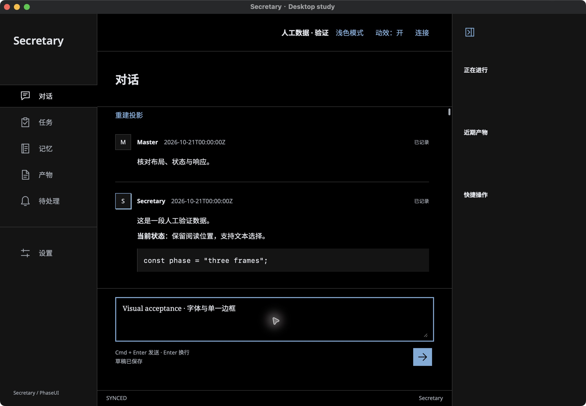
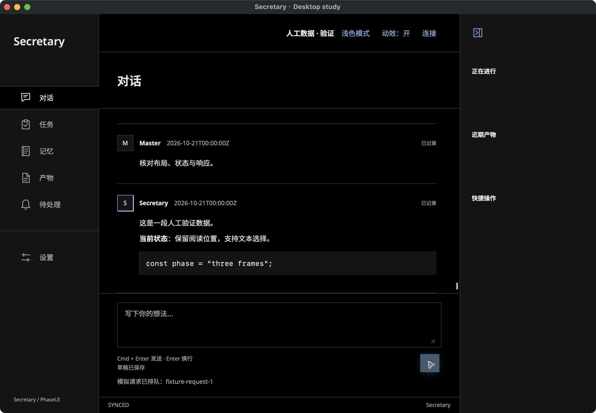

# Master visual revision — 2026-10-22

This revision implements Master's seven concrete corrections on PR #77. It is not merged or visually accepted by Master yet.

- Native scrollbars inherit the theme and use the document background, including the dark Conversation scroller.
- Divider frames replace two, two and three distinct short source segments, respectively, displaced both upward and downward. The original segments are masked out; no colored residue or intact duplicate is drawn. Contact probability, cooldown, global concurrency and cancellation stay bounded.
- The input reconstructs its single existing border with two local gaps per frame. Its single2px outer border owns focus indication; the textarea does not add a second rectangle. Typing/caret interactions still do not retrigger the effect.
- Offline Noto Sans UI, Noto Serif conversation/editor text (code retains system monospace), and Noto Sans SC (the Simplified Chinese Noto Sans CJK member) are bundled with OFL licenses. Latin normal and italic faces and CJK normal use variable100–900 weights, with font synthesis disabled; the bundle contains the upstream glyph sets without application-specific subsetting. Noto Sans SC supplies Chinese fallback for both UI and session text.
- The brand uses plain black Noto Sans in light mode and readable semantic ink in dark mode, without static or animated colored fringes.
- Send status is below the editor. A real receipt means local durable outbox acceptance, not remote completion. The artificial-data instance explicitly says “模拟请求已排队”; its fixture request ID is an in-memory simulated receipt.
- The heading's lower rule aligns with the Conversation row's lower rule through shared height tokens. Sending no longer inserts a banner above the transcript.

## Current validation

Core verification:616 pass,41 local database-dependent skips,0 failures. Real native bridge:5 tests passed, including durable send with the revised status and its position, reload/reattach, save failure recovery and responsiveness while Core is paused. Ordinary Release security checks passed (no native driver dependency and no main-process TCP listener).

24 Node tests and 6 Python tests passed; Svelte reports zero errors/warnings. Native WKWebView: 8 PhaseUI regression tests, 4 gallery tests and 3 visual-revision tests passed. The latter verify actual font loads, header alignment within one CSS pixel at 1180/600/480 widths and14/18px text sizes, dark scrollbar style, single editor focus border, receipt location and three distinct multiple-gap reconstructions. Frozen captures wait for two animation frames before capture; they do not establish real-time frame delivery.

Ordinary Release was also operated through computer use: theme toggle, native editor input and send receipt placement. The screenshots below are from that ordinary binary, with artificial data. The input screenshot shows an enabled send button; the receipt screenshot shows the cleared draft.

The R9 review required concrete geometry/font/layout parameters, current frontend spec and localization updates, and a full re-measurement. These are accepted; R10 returned conditional PASS with one required correction: retain monospace code. That correction is adopted; exact-source review is pending. The five other R8 visual differences remain pending Master disposition. System scrollbar preference combinations (Always/When scrolling) have not been independently exercised; actual application light/dark scrolling has.

The previous 87 measurements in resource-tables.md remain evidence for the previous e1efb80 binary only. New measurements, exact-head CI and same-session Claude revision review are pending. System Chinese IME candidate acceptance, VoiceOver speech, Master's visual/resource acceptance and deferred Linux desktop status are unchanged.

## Frozen diagnostic frames

Native-test captures after two rendering callbacks, used only for static geometry. Live frame delivery is measured separately.

- [divider frame 1](revision-divider-frame-1.png)
- [divider frame 2](revision-divider-frame-2.png)
- [divider frame 3](revision-divider-frame-3.png)
- [input frame 1](revision-input-frame-1.png)
- [input frame 2](revision-input-frame-2.png)
- [input frame 3](revision-input-frame-3.png)

Bundled WOFF2 files total11,543,504 bytes (11.01MiB). The ordinary macOS app bundle is29.46MiB. These are packaged sizes, not runtime RSS. Decoration is suppressed while document fonts load and never queued for a later replay.
