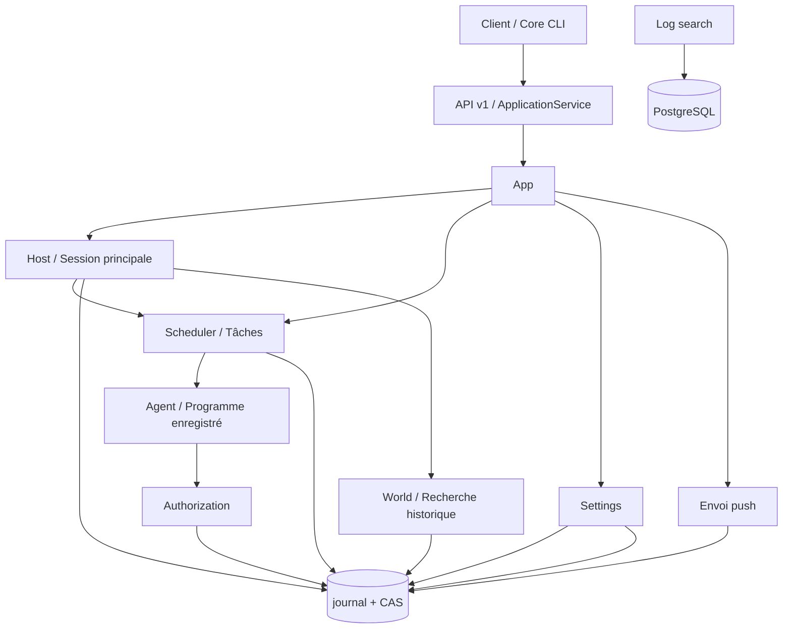

# Architecture

[English](../en/architecture.md) | [日本語](../ja/architecture.md) | [Français](architecture.md) | [中文](../architecture.md)

<!-- Generated by npm run docs:localize; edit docs/i18n/translations.json. -->

Secretary Core est un service local d’assistance personnelle persistante. La session principale organise la mémoire, les tâches et les échanges avec Master ; Scheduler fait progresser l’exécution ; le code hôte gère l’autorisation, la persistance et la reprise. Les clients accèdent à l’état métier via l’[API v1](api/v1/README.md).

## Modules et dépendances

Les sources se trouvent dans `src/pi_secretary/src` ; [App.open / pump](../../src/pi_secretary/src/app.ts) constitue le point d’entrée pour l’assemblage et la progression.

| Module | Rôle |
| --- | --- |
| [core-cli / core-client](../../src/pi_secretary/src/core-client.ts), [backend](../../src/pi_secretary/src/backend.ts) | Démarrer, découvrir, joindre et arrêter Core en arrière-plan |
| [api-v1](../../src/pi_secretary/src/api-v1.ts), [application-service](../../src/pi_secretary/src/application-service.ts) | Authentification HTTP, admission des commandes, idempotence et DTO publics ; `api/` contient les contrats et projections |
| [host](../../src/pi_secretary/src/host.ts), [main-loop](../../src/pi_secretary/src/main-loop.ts), [main-tools](../../src/pi_secretary/src/main-tools.ts) | Dépendances de la session principale, lots d’entrées, outils et reprise ; context-assembly et memory-* gèrent le contexte et la mémoire |
| [scheduler](../../src/pi_secretary/src/scheduler.ts), [task-planning](../../src/pi_secretary/src/task-planning.ts), [task-triggers](../../src/pi_secretary/src/task-triggers.ts) | Propositions de tâches, continuations, travail arrivé à échéance, préconditions et créneaux d’exécution |
| [execution-runner](../../src/pi_secretary/src/execution-runner.ts), [executor-tools](../../src/pi_secretary/src/executor-tools.ts), [effects](../../src/pi_secretary/src/effects.ts) | Modèles d’exécution, effets sur les fichiers et processus, résultats ; execution-recovery et retention gèrent la reprise et l’archivage |
| [authorization](../../src/pi_secretary/src/authorization.ts), [scopes](../../src/pi_secretary/src/scopes.ts) | Permissions des opérations, règles persistantes, détermination des effets, racines de travail et occupation des répertoires |
| [settings](../../src/pi_secretary/src/settings.ts), [world](../../src/pi_secretary/src/world.ts) | Settings activation; Store-backed World facts and independent PostgreSQL log search |
| [sync-service](../../src/pi_secretary/src/sync-service.ts), [notification-service](../../src/pi_secretary/src/notification-service.ts), [push-service](../../src/pi_secretary/src/push-service.ts) | Changements incrémentaux, suivi d’affichage et de lecture, envoi push indépendant ; wakeups gère les entrées programmées |
| [transport](../../src/pi_secretary/src/transport.ts), [store](../../src/pi_secretary/src/store.ts) | Conserver les requêtes et réponses des modèles ; committer l’état métier et les références d’objets |

Pi Agent et les adaptateurs de modèles utilisent des dépendances à version fixe ; leur provenance figure dans [UPSTREAM.json](../../src/UPSTREAM.json). Les schémas de l’API publique et de persistance interne sont maintenus séparément. L’[index de la documentation](README.md) renvoie aux fichiers générés, aux tests et aux archives.

## Processus et concurrence

Un seul writer Core, détenteur du verrou, gère chaque répertoire de données et son unique session principale. Host traite les lots d’entrées en série. Scheduler autorise deux exécuteurs par défaut ; `SECRETARY_MAX_WORKERS` modifie ce plafond. Les exécutions d’un même Scope DIRECTORY occupent la racine liée en série. Les tâches NONE ou sans Scope utilisent chacune leur propre `workspaces/<task_id>/work`.

Core ouvre Store, vérifie les conditions de mise à niveau et établit les identités et profils, puis importe ou initialise World genesis avant de restaurer Authorization/Scheduler et de construire Host/Settings. Il initialise ensuite le schéma indépendant de recherche des journaux et les index de lecture. L’API appelle pump toutes les 300 ms pour faire avancer notifications, recherche, World, paramètres, tâches, retours, réveils et Main. Chaque module gère ses traitements en cours ; l’arrêt ferme modèles, exécuteurs, connexions SQL et writer.

[process-control](../../src/pi_secretary/src/process-control.ts) lance shell/program via un wrapper Python : celui-ci annonce d’abord l’identité du processus et n’accepte la trame de démarrage qu’après sa persistance. Les résultats des effets et l’arrêt du processus sont enregistrés séparément. bash s’exécute avec les droits de l’utilisateur local dans le répertoire lié ; les lectures/écritures de fichiers et d’artefacts vérifient les chemins dans la racine. Les programmes enregistrés vérifient la révision et le SHA-256 du point d’entrée et échangent ProgramInvocation/ProgramResult sur stdin/stdout.

## Données et commits

`record_type + id` identifie un enregistrement ; revision contrôle les mises à jour ; ObjectRef référence l’original par SHA-256, longueur en octets et type de média. Session/Input conservent les entrées de la session principale ; TaskPlan/Execution/TaskResult, les tours des tâches ; Consciousness/MemoryExtractionJob, la mémoire de travail et sa provenance ; Operation, un effet externe. Les champs figurent dans la [référence générée](data/README.md).

Store écrit d’abord les objets CAS, puis valide et ajoute une transaction au journal chaîné par hachage. Il installe l’état et les index en mémoire après réception de l’ACK fsync. Un worker communique par tubes anonymes avec le helper Python détenteur du verrou ; l’ID de requête, sequence et digest lient la confirmation d’ajout. Le commit et la relecture vérifient les fichiers référencés et leur longueur ; la lecture du contenu vérifie le hachage complet. Les nouveaux Context utilisent des manifestes ordonnés de références de messages ; `Store.read` accepte les manifestes et les anciens tableaux de messages.

[Catalogue des états](../../src/state_machine/catalog.json) définit Execution, Operation, Input et Authorization. Store valide les trois premiers lors du commit et du rejeu ; Authorization progresse par événements, les autres enregistrements par modules métier. World commits records, grants and results atomically to the journal; legacy SQL is imported read-only once. Les index de recherche, timeline et activité sont reconstructibles depuis les sources de référence. Voir [Invariants du système](invariants.md).

## Limites actuelles

- Store relit tout le journal au démarrage et conserve les anciennes trames et les logs en mémoire. L’accélération par instantanés et la récupération de l’espace historique ne sont pas encore implémentées.
- Context partage les objets de messages, mais les requêtes aux modèles et les payloads fournisseurs conservent des instantanés complets ; le stockage total peut croître de façon quadratique dans les longues boucles.
- shell/program s’exécute avec les droits de l’utilisateur local ; Scope fournit les contraintes de liaison aux répertoires, d’ordonnancement et d’outils de fichiers.

## Conservation des données et retrait

Le `retention_state=RETIRED` d’Execution est distinct du `state` terminal et n’autorise aucune suppression. [retention](../../src/pi_secretary/src/retention.ts) exige une exécution terminée, aucune demande, opération inconnue ou suite en attente, tous les Feedback `HANDLED`/`SUPPRESSED`, et un délai depuis `max(ended_at, last_activity_at)` atteignant `retire_after_seconds` (172800 secondes à la création). Il lit les octets CAS des événements et détails du résultat, enregistre ArchiveManifest et le retrait, sans supprimer journal, CAS ou espace de travail. Listes, détails et navigation Task ne renouvellent pas ce délai ; `viewed` explicite ne le réinitialise qu’avant retrait. Après retrait, le détail ne retourne que l’identité et le manifeste, les artefacts sont `archived` et la continuation refuse ce parent (`PARENT_NOT_RESUMABLE`).

La sauvegarde et la restauration doivent couvrir ensemble le répertoire Core, sa base PostgreSQL, les brouillons et données de récupération du client, ainsi que les racines Scope externes. Un instantané CAS et le fichier de travail courant sont distincts et ne se remplacent pas ; combiner une base et un journal de dates différentes ne constitue pas une restauration complète. Voir les [opérations](operations.md#sauvegardes-et-mises-à-niveau) et le test de conservation dans les [tests runtime](../../test_case/offline/runtime/runtime.test.ts).

## Scope import transactions

Main-originated `scope.import` uses the same restricted `AUTHORIZED --journal_apply--> SUCCEEDED` transition as `world.change`, with a separate whole-frame guard. The Scope frame contains exactly the consumed grant, deterministic new Scope, Operation receipt and HOST-produced ENVIRONMENT Input. World frames retain their own guard and create no automatic result Input; external-effect operations cannot use this transition. Expiry and definite failure cancel without effect, and rejection/revocation notification reconciliation runs on startup and every pump.

ENVIRONMENT result Inputs are isolated at their original input-order position and have a read/query/report tool allowlist. They are excluded from Master quote/commitment extraction, kept as HOST notices in summaries and conversation history, and excluded from Master-input search. Scope status remains queryable through `scope_query`. No Task, Execution or Feedback is fabricated for the report.

Historical import replay checks the stored atomic bundle, deterministic IDs, grant transition and HOST provenance without regenerating notice text, current Scope content or CAS objects. Exact content and current filesystem checks remain live-commit admission rules. Directory identity uses device/inode: delete/recreate with inode reuse is not distinguishable by this check and is not an adversarial filesystem lock.

## Shared workspace projections

Omitted or null `scope_id` selects the built-in virtual Shared group; it never creates a Scope record. Explicit invalid, archived or unavailable Scopes fail. A named NONE Scope remains distinct. Shared and NONE use independent durable `<data/core>/workspaces/<task_id>/work` directories; task continuation retains these files, and completion/retirement never deletes them. Existing owner-managed DIRECTORY root changes still affect future executions, while historical Execution bindings remain immutable.

Task query/acceptance, API task/execution/result details and terminal Task details expose `scope_kind`, `scope_name` and `workspace_info` (absolute `path`, `root_kind`, `location=CORE_HOST`, `availability`, `reason`). An unbound path is `planned`, even if initialization has already created it; `verified` means the bound directory passed the current read-only filesystem check, not a permanent guarantee. Missing or unsafe bound roots are `unavailable` with a diagnostic reason. They are never recreated as empty historical recovery. Paths belong to the Core host, not a remote client. Artifact CAS delivery and remote `/open` restrictions are unchanged; a path display does not authorize another Task's files or provide an OS sandbox.
