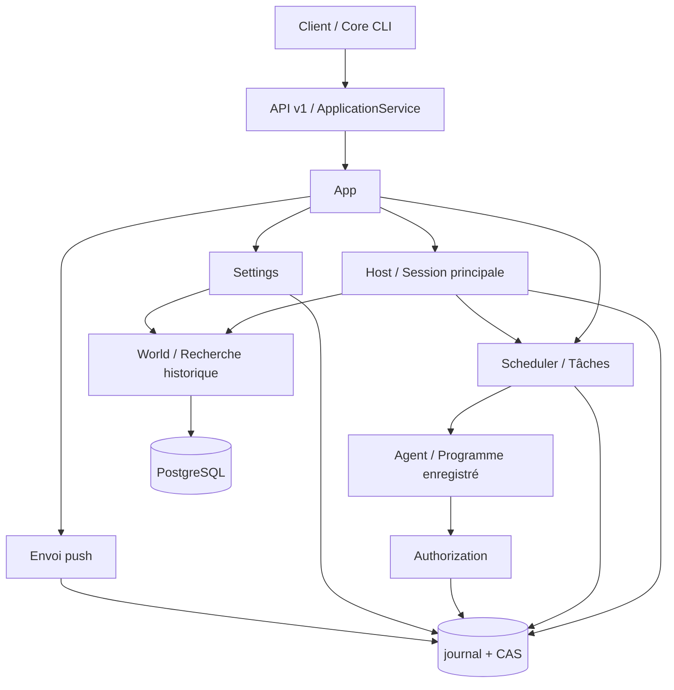

# Architecture

[English](../en/architecture.md) | [日本語](../ja/architecture.md) | [Français](architecture.md) | [中文](../architecture.md)

<!-- Generated by npm run docs:localize; edit docs/i18n/translations.json. -->

Secretary Core est un service local d’assistance personnelle persistante. La session principale organise la mémoire, les tâches et les échanges avec Master ; Scheduler fait progresser l’exécution ; le code hôte gère l’autorisation, la persistance et la reprise. Les clients accèdent à l’état métier via l’[API v1](api/v1/README.md).

## Modules et dépendances

Les sources se trouvent dans `src/pi_secretary/src` ; [App.open / pump](../../src/pi_secretary/src/app.ts) constitue le point d’entrée pour l’assemblage et la progression.

| Module | Rôle |
| --- | --- |
| [core-cli / core-client](../../src/pi_secretary/src/core-client.ts), [backend](../../src/pi_secretary/src/backend.ts) | Démarrer, découvrir, joindre et arrêter Core en arrière-plan |
| [api-v1](../../src/pi_secretary/src/api-v1.ts), [application-service](../../src/pi_secretary/src/application-service.ts) | Authentification HTTP, admission des commandes, idempotence et DTO publics ; `api/` contient les contrats et projections |
| [host](../../src/pi_secretary/src/host.ts), [main-loop](../../src/pi_secretary/src/main-loop.ts), [main-tools](../../src/pi_secretary/src/main-tools.ts) | Dépendances de la session principale, lots d’entrées, outils et reprise ; context-assembly et memory-* gèrent le contexte et la mémoire |
| [scheduler](../../src/pi_secretary/src/scheduler.ts), [task-planning](../../src/pi_secretary/src/task-planning.ts), [task-triggers](../../src/pi_secretary/src/task-triggers.ts) | Propositions de tâches, continuations, travail arrivé à échéance, préconditions et créneaux d’exécution |
| [execution-runner](../../src/pi_secretary/src/execution-runner.ts), [executor-tools](../../src/pi_secretary/src/executor-tools.ts), [effects](../../src/pi_secretary/src/effects.ts) | Modèles d’exécution, effets sur les fichiers et processus, résultats ; execution-recovery et retention gèrent la reprise et l’archivage |
| [authorization](../../src/pi_secretary/src/authorization.ts), [scopes](../../src/pi_secretary/src/scopes.ts) | Permissions des opérations, règles persistantes, détermination des effets, racines de travail et occupation des répertoires |
| [settings](../../src/pi_secretary/src/settings.ts), [world](../../src/pi_secretary/src/world.ts) | Changement de configuration, faits structurés et transfert des accusés de réception PostgreSQL |
| [sync-service](../../src/pi_secretary/src/sync-service.ts), [notification-service](../../src/pi_secretary/src/notification-service.ts), [push-service](../../src/pi_secretary/src/push-service.ts) | Changements incrémentaux, suivi d’affichage et de lecture, envoi push indépendant ; wakeups gère les entrées programmées |
| [transport](../../src/pi_secretary/src/transport.ts), [store](../../src/pi_secretary/src/store.ts) | Conserver les requêtes et réponses des modèles ; committer l’état métier et les références d’objets |

Pi Agent et les adaptateurs de modèles utilisent des dépendances à version fixe ; leur provenance figure dans [UPSTREAM.json](../../src/UPSTREAM.json). Les schémas de l’API publique et de persistance interne sont maintenus séparément. L’[index de la documentation](README.md) renvoie aux fichiers générés, aux tests et aux archives.

## Processus et concurrence

Un seul writer Core, détenteur du verrou, gère chaque répertoire de données et son unique session principale. Host traite les lots d’entrées en série. Scheduler autorise deux exécuteurs par défaut ; `SECRETARY_MAX_WORKERS` modifie ce plafond. Les exécutions d’un même Scope DIRECTORY occupent la racine liée en série. Les tâches NONE ou sans Scope utilisent chacune leur propre `workspaces/<task_id>/work`.

Au démarrage, Core ouvre Store, restaure Authorization et Scheduler, puis construit Host et Settings et prépare les index de lecture. L’API appelle pump toutes les 300 ms pour faire progresser l’envoi push, la recherche, World, les paramètres, les tâches, les retours, les réveils et la session principale. Chaque module gère ses opérations en cours. L’arrêt ferme les modèles, les exécuteurs, les connexions à la base et le writer.

[process-control](../../src/pi_secretary/src/process-control.ts) lance shell/program via un wrapper Python : celui-ci annonce d’abord l’identité du processus et n’accepte la trame de démarrage qu’après sa persistance. Les résultats des effets et l’arrêt du processus sont enregistrés séparément. bash s’exécute avec les droits de l’utilisateur local dans le répertoire lié ; les lectures/écritures de fichiers et d’artefacts vérifient les chemins dans la racine. Les programmes enregistrés vérifient la révision et le SHA-256 du point d’entrée et échangent ProgramInvocation/ProgramResult sur stdin/stdout.

## Données et commits

`record_type + id` identifie un enregistrement ; revision contrôle les mises à jour ; ObjectRef référence l’original par SHA-256, longueur en octets et type de média. Session/Input conservent les entrées de la session principale ; TaskPlan/Execution/TaskResult, les tours des tâches ; Consciousness/MemoryExtractionJob, la mémoire de travail et sa provenance ; Operation, un effet externe. Les champs figurent dans la [référence générée](data/README.md).

Store écrit d’abord les objets CAS, puis valide et ajoute une transaction au journal chaîné par hachage. Il installe l’état et les index en mémoire après réception de l’ACK fsync. Un worker communique par tubes anonymes avec le helper Python détenteur du verrou ; l’ID de requête, sequence et digest lient la confirmation d’ajout. Le commit et la relecture vérifient les fichiers référencés et leur longueur ; la lecture du contenu vérifie le hachage complet. Les nouveaux Context utilisent des manifestes ordonnés de références de messages ; `Store.read` accepte les manifestes et les anciens tableaux de messages.

Le [catalogue des états](../../src/state_machine/catalog.json) conserve Execution, Operation, Input et Authorization. Store vérifie les transitions des trois premiers au commit et à la relecture ; Authorization progresse par événements. Les autres enregistrements relèvent des modules métier. World enregistre les faits, accusés de réception et outbox dans une transaction PostgreSQL, puis les importe dans le journal à partir des accusés de réception. Les index de recherche, de timeline et d’activité sont reconstructibles à partir des enregistrements faisant autorité. Voir les [invariants du système](invariants.md).

## Limites actuelles

- Store relit tout le journal au démarrage et conserve les anciennes trames et les logs en mémoire. L’accélération par instantanés et la récupération de l’espace historique ne sont pas encore implémentées.
- Context partage les objets de messages, mais les requêtes aux modèles et les payloads fournisseurs conservent des instantanés complets ; le stockage total peut croître de façon quadratique dans les longues boucles.
- shell/program s’exécute avec les droits de l’utilisateur local ; Scope fournit les contraintes de liaison aux répertoires, d’ordonnancement et d’outils de fichiers.
