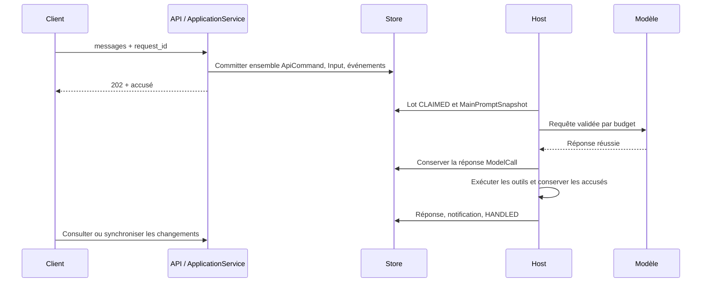
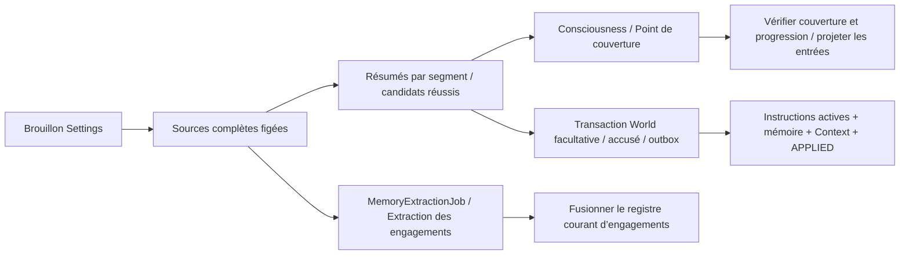
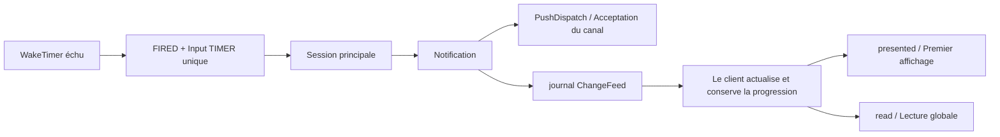

# Flux de données

[English](../en/data-flow.md) | [日本語](../ja/data-flow.md) | [Français](data-flow.md) | [中文](../data-flow.md)

<!-- Generated by npm run docs:localize; edit docs/i18n/translations.json. -->

## De l’entrée à la réponse

[ApplicationService](../../src/pi_secretary/src/application-service.ts) lie l’admission au premier changement métier. La [boucle principale](../../src/pi_secretary/src/main-loop.ts) fige les instructions, outils et Scopes du tour ; [durableStream](../../src/pi_secretary/src/transport.ts) persiste la réponse réussie avant de la remettre à Agent pour exécuter les outils. La reprise réutilise les réponses et accusés d’outils enregistrés ; les aperçus temporaires sont liés aux messages finaux par call_id. `MasterInteract` crée des notifications ; les réponses finales ordinaires et les notifications sont conservées séparément dans l’historique.

## De la proposition de tâche au résultat

```mermaid
flowchart LR
  Proposal[task_propose] --> Plan[TaskPlan / Requête en file]
  Plan --> Due[Échéances et préconditions]
  Due --> Execution[Execution / Proposition et racine figées]
  Execution --> Slot[Obtenir un créneau d’exécution]
  Slot --> Tool[Outils Agent / Programme enregistré]
  Tool --> Auth[Préparer Operation / règle ou approbation]
  Auth --> Effect[Dispatcher et persister les effets]
  Effect --> Result[submit_result / TaskResult / Artefacts CAS]
  Effect --> Unknown[RESULT_UNKNOWN / Vérifier ou déterminer]
  Unknown --> Result
  Result --> Feedback[Feedback / Entrée de session principale]
```

[task-planning](../../src/pi_secretary/src/task-planning.ts) enregistre l’objectif complet, les contraintes, critères d’acceptation et documents ; [task-triggers](../../src/pi_secretary/src/task-triggers.ts) prend en charge IMMEDIATE, AT et INTERVAL. Les [outils d’exécution](../../src/pi_secretary/src/executor-tools.ts) sont read, write, bash, request_decision et submit_result ; l’exécution se suspend en attente d’approbation ou d’une réponse de travail. write est autorisé par défaut dans la racine liée ; DIRECTORY permet `default_write=ask`. [shell-policy](../../src/pi_secretary/src/shell-policy.ts) convertit les commandes simples en lecture seule en argv fixe ; les autres passent par l’autorisation. Approuver et mémoriser enregistre l’autorisation et la règle dans une même transaction ; règles et ressources sont revérifiées avant dispatch.

`reuse_task_id + parent_execution_id` crée une continuation immédiate dans la même tâche. Le parent doit être la dernière exécution, terminée et non archivée. goal est l’objectif complet du tour ; contraintes, critères, échéance et exécuteur omis ou null sont hérités ; les tableaux explicites remplacent les champs. Le Scope reste celui de la tâche ; les continuations n’ont ni at ni interval. Chaque nouvelle Execution fige sa proposition et sa racine de travail courante ; les anciens enregistrements restent. L’exécuteur soumet les évaluations par critère avec `verified_by=NOT_VERIFIED` ; les artefacts sont des versions CAS fixes. La rétention HOT est de 48 heures par défaut, prolongeable par viewed ; [retention](../../src/pi_secretary/src/retention.ts) archive ensuite les exécutions admissibles.

## Maintenance de la mémoire et paramètres

La [maintenance mémoire](../../src/pi_secretary/src/memory-maintenance.ts) valide séparément les résumés et la progression d’extraction, et réessaie les segments en échec selon les compteurs persistés. [Settings](../../src/pi_secretary/src/settings.ts) fige le brouillon et les sources, puis suspend la session principale et la prise de nouvelles tâches. Il termine le résumé et les contrôles de capacité, valide le lot World et transfère son accusé, puis bascule atomiquement la configuration locale. Un changement d’instructions seul reconstruit directement Context. Les nouvelles entrées attendent ; les tâches en cours peuvent finir. Un redémarrage en COMMITTING/REBUILDING rapproche les accusés de la base ; les lots manuels FAILED peuvent restaurer leur brouillon, tandis que BLOCKED poursuit la consultation des résultats validés. Voir [mémoire et prompts](memory-and-prompts.md) pour les règles de retrait et de provenance.

## Synchronisation, rappels et notifications

[wakeups](../../src/pi_secretary/src/wakeups.ts) délivre les minuteries échues dans pump et rattrape au démarrage celles arrivées à échéance pendant l’arrêt. TIMER conserve la provenance et le retard ; la session principale décide de notifier. [SyncService](../../src/pi_secretary/src/sync-service.ts) fournit des curseurs durables sur les transactions du journal. Les clients obtiennent un point de progression, chargent les ressources, rattrapent les changements puis ouvrent SSE ; mises à jour record et rafraîchissements invalidate maintiennent les vues agrégées. Le [service de notifications](../../src/pi_secretary/src/notification-service.ts) enregistre séparément le premier affichage par client et la première lecture globale. Le [worker push](../../src/pi_secretary/src/push-service.ts) gère indépendamment l’envoi, les plages de silence et les nouvelles tentatives. Le protocole client figure dans l’[API v1](api/v1/README.md).

## Limites actuelles

- Les réveils programmés nécessitent un Core actif ; ceux échus pendant la veille système sont délivrés à la reprise.
- L’envoi push utilise des tentatives bornées et peut produire des doublons ; acceptation du canal et affichage client sont enregistrés séparément.
