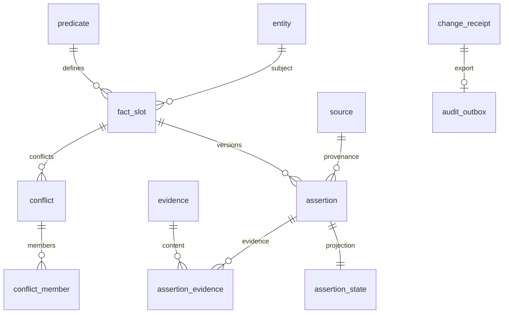

# PostgreSQL schema

[English](../en/database.md) | [日本語](../ja/database.md) | [Français](database.md) | [中文](../database.md)

<!-- Generated by npm run docs:localize; edit docs/i18n/translations.json. -->

Les faits faisant autorité de World Model utilisent le schéma `wm` ; les index reconstruisibles des textes historiques utilisent `mem`. Session, Task, règles d’autorisation, Context et Consciousness résident dans le journal local, pas dans des tables PostgreSQL.

SQL faisant autorité : [001_world_model.sql](../../src/schema/001_world_model.sql), [002_predicates.sql](../../src/schema/002_predicates.sql), [003_settings.sql](../../src/schema/003_settings.sql), [004_memory_search.sql](../../src/schema/004_memory_search.sql), [queries.sql](../../src/schema/queries.sql). Code du dépôt d’exécution : [world.ts](../../src/pi_secretary/src/world.ts).

## Migrations et transactions

World.migrate sérialise les migrations par verrou consultatif. Sans schema_version, il installe la base, applique les prédicats initiaux et consigne la version 2, puis la version 3 pour settings_batch_receipt et la version 4 pour mem/aliases. Base et seed ont leurs transactions ; migrate annule et libère le verrou en cas d’échec. Le propriétaire appelle explicitement POST /api/v1/admin/world/migrate puis confirme via l’accusé. Core CLI ne traite pas --migrate.

Les changements passent par le coordinateur Settings pour résumé et vérification préalable du contexte. L’API Settings authentifiée local-owner consigne une preuve explicite d’application ; les propositions de modèles restent soumises à autorisation. Les transactions vérifient entités, prédicats et révisions de slot puis committent le lot entier avec settings_batch_receipt. change_id/request_id/request_hash assurent déduplication et détection des conflits. Assertions, projections d’état, conflits, preuves, change_receipt et audit_outbox sont committés ensemble ; l’export d’audit JSONL est un transfert distinct et récupérable.

## Relations



## Champs et contraintes des tables

Les définitions suivantes sont générées directement du SQL courant, avec valeurs par défaut, clés étrangères, CHECK, UNIQUE et contraintes différées.

### wm.schema_version

```sql
version integer PRIMARY KEY CHECK (version > 0),
    installed_at timestamptz NOT NULL DEFAULT now()
```

### wm.entity

```sql
entity_id uuid PRIMARY KEY,
    kind text NOT NULL CHECK (kind IN ('PERSON','ORGANIZATION','PROJECT','DEVICE','SERVICE','RESOURCE','GOAL')),
    display_name text NOT NULL CHECK (length(display_name)>0),
    external_key text UNIQUE,
    revision bigint NOT NULL DEFAULT 1 CHECK (revision>0),
    retired_at timestamptz,
    created_at timestamptz NOT NULL DEFAULT now(),
    updated_at timestamptz NOT NULL DEFAULT now()
```

### wm.source

```sql
source_id uuid PRIMARY KEY,
    kind text NOT NULL CHECK (kind IN ('MASTER','OBSERVATION','TASK_REPORT','MODEL_INFERENCE')),
    source_key text NOT NULL UNIQUE,
    description text NOT NULL,
    retired_at timestamptz
```

### wm.predicate

```sql
predicate_key text PRIMARY KEY CHECK (predicate_key ~ '^[a-z][a-z0-9_.]+$'),
    description text NOT NULL,
    subject_kinds text[] NOT NULL CHECK (cardinality(subject_kinds)>0),
    value_type text NOT NULL CHECK (value_type IN ('STRING','NUMBER','BOOLEAN','OBJECT','ARRAY','ENTITY')),
    cardinality text NOT NULL CHECK (cardinality IN ('SINGLE','MULTI')),
    unit text,
    value_schema jsonb NOT NULL CHECK (jsonb_typeof(value_schema)='object'),
    definition_revision bigint NOT NULL DEFAULT 1 CHECK (definition_revision>0)
```

### wm.fact_slot

```sql
slot_id uuid PRIMARY KEY,
    subject_id uuid NOT NULL REFERENCES wm.entity(entity_id),
    predicate_key text NOT NULL REFERENCES wm.predicate(predicate_key),
    scope_key text NOT NULL DEFAULT '',
    revision bigint NOT NULL DEFAULT 0 CHECK (revision>=0),
    UNIQUE(subject_id,predicate_key,scope_key)
```

### wm.change_receipt

```sql
change_id uuid PRIMARY KEY,
    request_id uuid NOT NULL UNIQUE,
    request_hash text NOT NULL CHECK (request_hash ~ '^[0-9a-f]{64}$'),
    outcome text NOT NULL CHECK (outcome IN ('APPLIED','CONFLICT','REJECTED')),
    result jsonb NOT NULL CHECK (jsonb_typeof(result)='object'),
    committed_at timestamptz NOT NULL DEFAULT now()
```

### wm.assertion

```sql
assertion_id uuid PRIMARY KEY,
    slot_id uuid NOT NULL REFERENCES wm.fact_slot(slot_id),
    slot_revision bigint NOT NULL CHECK (slot_revision>0),
    source_id uuid NOT NULL REFERENCES wm.source(source_id),
    change_id uuid NOT NULL REFERENCES wm.change_receipt(change_id) DEFERRABLE INITIALLY DEFERRED,
    value jsonb,
    object_entity_id uuid REFERENCES wm.entity(entity_id),
    epistemic text NOT NULL CHECK (epistemic IN ('OBSERVED','REPORTED','INFERRED','UNRESOLVED')),
    observed_at timestamptz,
    received_at timestamptz NOT NULL,
    valid_from timestamptz NOT NULL,
    valid_to timestamptz,
    fresh_until timestamptz,
    scope_description text NOT NULL CHECK (length(scope_description)>0),
    replaces_assertion_id uuid,
    UNIQUE(assertion_id,slot_id),
    UNIQUE(slot_id,slot_revision),
    FOREIGN KEY(replaces_assertion_id,slot_id) REFERENCES wm.assertion(assertion_id,slot_id),
    CHECK ((value IS NOT NULL AND value <> 'null'::jsonb AND object_entity_id IS NULL)
        OR (value IS NULL AND object_entity_id IS NOT NULL)),
    CHECK (valid_to IS NULL OR valid_to>valid_from),
    CHECK (fresh_until IS NULL OR fresh_until>=valid_from),
    CHECK (epistemic<>'OBSERVED' OR observed_at IS NOT NULL),
    CHECK (replaces_assertion_id IS NULL OR replaces_assertion_id<>assertion_id)
```

### wm.assertion_state

```sql
assertion_id uuid PRIMARY KEY,
    slot_id uuid NOT NULL,
    status text NOT NULL CHECK (status IN ('ACTIVE','SUPPORTING','CONTESTED','RETRACTED','SUPERSEDED')),
    revision bigint NOT NULL DEFAULT 1 CHECK (revision>0),
    changed_by uuid NOT NULL REFERENCES wm.change_receipt(change_id) DEFERRABLE INITIALLY DEFERRED,
    changed_at timestamptz NOT NULL DEFAULT now(),
    FOREIGN KEY(assertion_id,slot_id) REFERENCES wm.assertion(assertion_id,slot_id)
```

### wm.evidence

```sql
evidence_id uuid PRIMARY KEY,
    log_event_id uuid NOT NULL,
    object_path text NOT NULL CHECK (object_path !~ '(^/|(^|/)\.\.(/|$))'),
    sha256 text NOT NULL CHECK (sha256 ~ '^[0-9a-f]{64}$'),
    media_type text NOT NULL,
    byte_count bigint NOT NULL CHECK (byte_count>=0),
    UNIQUE(log_event_id,sha256)
```

### wm.assertion_evidence

```sql
assertion_id uuid NOT NULL REFERENCES wm.assertion(assertion_id),
    evidence_id uuid NOT NULL REFERENCES wm.evidence(evidence_id),
    PRIMARY KEY(assertion_id,evidence_id)
```

### wm.conflict

```sql
conflict_id uuid PRIMARY KEY,
    slot_id uuid NOT NULL REFERENCES wm.fact_slot(slot_id),
    status text NOT NULL CHECK (status IN ('OPEN','RESOLVED')),
    opened_by uuid NOT NULL REFERENCES wm.change_receipt(change_id) DEFERRABLE INITIALLY DEFERRED,
    resolved_by uuid REFERENCES wm.change_receipt(change_id) DEFERRABLE INITIALLY DEFERRED,
    resolution_note text,
    UNIQUE(conflict_id,slot_id),
    CHECK ((status='OPEN' AND resolved_by IS NULL AND resolution_note IS NULL)
       OR (status='RESOLVED' AND resolved_by IS NOT NULL AND resolution_note IS NOT NULL AND length(resolution_note)>0))
```

### wm.conflict_member

```sql
conflict_id uuid NOT NULL,
    slot_id uuid NOT NULL,
    assertion_id uuid NOT NULL,
    PRIMARY KEY(conflict_id,assertion_id),
    FOREIGN KEY(conflict_id,slot_id) REFERENCES wm.conflict(conflict_id,slot_id),
    FOREIGN KEY(assertion_id,slot_id) REFERENCES wm.assertion(assertion_id,slot_id)
```

### wm.audit_outbox

```sql
event_id uuid PRIMARY KEY,
    change_id uuid NOT NULL UNIQUE REFERENCES wm.change_receipt(change_id),
    payload jsonb NOT NULL CHECK (jsonb_typeof(payload)='object'),
    created_at timestamptz NOT NULL DEFAULT now(),
    exported_journal_txn uuid,
    exported_at timestamptz,
    CHECK ((exported_journal_txn IS NULL)=(exported_at IS NULL))
```

### wm.settings_batch_receipt

```sql
application_id uuid PRIMARY KEY,
    request_hash text NOT NULL,
    result jsonb NOT NULL,
    committed_at timestamptz NOT NULL DEFAULT now()
```

### mem.document

```sql
source_id text NOT NULL,
    event_id uuid NOT NULL,
    log_sequence bigint NOT NULL,
    occurred_at timestamptz NOT NULL,
    kind text NOT NULL CHECK (kind IN ('input','reply','task','notification')),
    session_id uuid,
    scope_id uuid,
    task_id uuid,
    body_hash text NOT NULL,
    PRIMARY KEY (source_id,event_id)
```

### mem.chunk

```sql
source_id text NOT NULL,
    event_id uuid NOT NULL,
    chunk_index integer NOT NULL,
    body_offset integer NOT NULL,
    body text NOT NULL,
    PRIMARY KEY (source_id,event_id,chunk_index),
    FOREIGN KEY (source_id,event_id) REFERENCES mem.document ON DELETE CASCADE
```

### mem.checkpoint

```sql
singleton boolean PRIMARY KEY DEFAULT true CHECK (singleton),
    source_id text NOT NULL,
    policy_version integer NOT NULL,
    journal_sequence bigint NOT NULL,
    journal_digest text NOT NULL,
    document_count bigint NOT NULL,
    chunk_count bigint NOT NULL
```

## Index, déclencheurs et modèles de lecture

Un index unique partiel sur assertion_state garantit au plus un ACTIVE par slot ; conflict autorise au plus un OPEN par slot. Les index temporels source/slot servent aux lectures de faits ; pending_audit_exports permet le parcours des événements non exportés.

validate_slot vérifie subject kind et scope_key SINGLE/MULTI ; validate_assertion contrôle revision du slot, types de valeurs et références ENTITY. assertion, receipt, evidence et leurs liens ne peuvent être modifiés ni supprimés ; l’identité source est immuable ; les déclencheurs différés exigent des preuves pour chaque assertion. Corrections et retraits utilisent de nouveaux changements et projections. settings_batch_receipt interdit aussi modification/suppression pour préserver l’idempotence des lots.

La couche World utilise Ajv pour valider predicate.value_schema et vérifie les objets de preuve et CAS. queries.sql renvoie projections courantes, conflits, provenance et informations de validité.

## Catalogue initial des prédicats

Les dix prédicats initiaux sont person.display_name, person.height, person.contact, person.member_of, preference.statement, goal.statement, project.constraint, resource.location, resource.depends_on et resource.observed_state. Types, cardinalités, unités et contraintes JSON sont définis par 002_predicates.sql. Ils décrivent les types de faits enregistrables dans World.

## Configuration de la base de données

World utilise une base dédiée ; rôles de connexion et sauvegardes sont configurés par l’environnement de déploiement. Le DDL révoque les droits PUBLIC ; l’autorisation owner Core est gérée dans l’application.

## Recherche dans l’historique et alias

La version 4 installe pg_trgm, ajoute wm.entity.aliases (text[] non nul, tableau vide par défaut) et crée mem.document, mem.chunk et mem.checkpoint. Les alias sont maintenus par Settings/WorldCatalogChange autorisés ; les anciens changements ENTITY préservent les alias omis. Plusieurs correspondances de nom ou d’alias renvoient des candidats.

La projection de recherche avance par étapes bornées depuis les trames du journal. Le texte complet est découpé aux frontières Unicode ; texte et progression sont validés ensemble. La progression lie source, version de politique et digest du journal ; une source différente ou des données manquantes au redémarrage déclenchent la reconstruction. Les faits wm faisant autorité ne sont pas affectés.

Le texte utilise GIN pg_trgm et ILIKE littéral paramétré. Les résultats sont dédupliqués par événement, puis triés par date décroissante et clé stable. Les périodes sont [from,to), avec filtres combinés. Le SQL expire après 5 secondes avec search_timeout. La locale détermine l’extraction des trigrammes ; correspondances chinoises et performances sont validées séparément dans la locale réelle. Les motifs de deux caractères peuvent dégénérer en parcours complet.

La recette de déploiement vérifie en lecture seule server_version, datctype, datcollate, datlocprovider, datlocale et datcollversion. Si la configuration diffère, répéter la validation chinoise dans une base isolée correspondante. Les instances contenant les données réelles ne servent pas aux tests. Les originaux se lisent par fragments dans journal/CAS ; mem est reconstructible.
