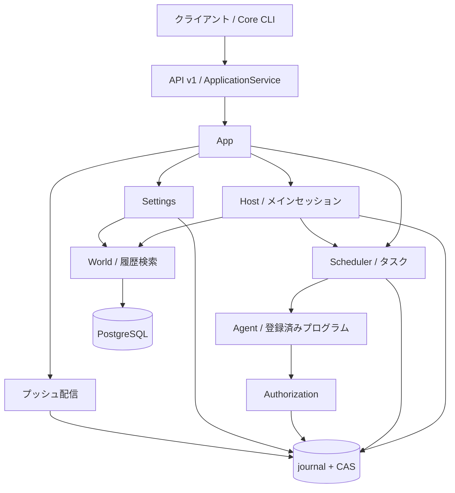

# アーキテクチャ

[English](../en/architecture.md) | [日本語](architecture.md) | [Français](../fr/architecture.md) | [中文](../architecture.md)

<!-- Generated by npm run docs:localize; edit docs/i18n/translations.json. -->

Secretary Core はローカルで動作する継続型パーソナルアシスタントサービスです。メインセッションはメモリ、タスク、Master とのやり取りをまとめ、Scheduler が実行を進めます。認可、永続化、復旧はホストコードが担います。クライアントは [API v1](api/v1/README.md) を通じて業務状態にアクセスします。

## モジュールと依存関係

ソースは `src/pi_secretary/src` にあります。[App.open / pump](../../src/pi_secretary/src/app.ts) が構成と処理推進の入り口です。

| モジュール | 役割 |
| --- | --- |
| [core-cli / core-client](../../src/pi_secretary/src/core-client.ts)、[backend](../../src/pi_secretary/src/backend.ts) | バックグラウンド Core の起動、検出、接続、停止 |
| [api-v1](../../src/pi_secretary/src/api-v1.ts)、[application-service](../../src/pi_secretary/src/application-service.ts) | HTTP 認証、コマンド受理、冪等性、公開 DTO。`api/` に契約と投影を保持 |
| [host](../../src/pi_secretary/src/host.ts)、[main-loop](../../src/pi_secretary/src/main-loop.ts)、[main-tools](../../src/pi_secretary/src/main-tools.ts) | メインセッションの依存関係、入力バッチ、ツール、復旧。context-assembly と memory-* がコンテキストとメモリを担当 |
| [scheduler](../../src/pi_secretary/src/scheduler.ts)、[task-planning](../../src/pi_secretary/src/task-planning.ts)、[task-triggers](../../src/pi_secretary/src/task-triggers.ts) | タスク提案、継続、期限到来処理、前提条件、実行スロット |
| [execution-runner](../../src/pi_secretary/src/execution-runner.ts)、[executor-tools](../../src/pi_secretary/src/executor-tools.ts)、[effects](../../src/pi_secretary/src/effects.ts) | 実行モデル、ファイル・プロセスへの作用、結果。execution-recovery と retention が復旧とアーカイブを担当 |
| [authorization](../../src/pi_secretary/src/authorization.ts)、[scopes](../../src/pi_secretary/src/scopes.ts) | 操作の許可、永続ルール、作用の判定、作業ルート、ディレクトリの占有 |
| [settings](../../src/pi_secretary/src/settings.ts)、[world](../../src/pi_secretary/src/world.ts) | 設定の切り替え、構造化された事実、PostgreSQL の受領記録の橋渡し |
| [sync-service](../../src/pi_secretary/src/sync-service.ts)、[notification-service](../../src/pi_secretary/src/notification-service.ts)、[push-service](../../src/pi_secretary/src/push-service.ts) | 差分変更、表示・既読管理、独立したプッシュ配信。wakeups が時刻指定入力を担当 |
| [transport](../../src/pi_secretary/src/transport.ts)、[store](../../src/pi_secretary/src/store.ts) | モデルのリクエスト・応答を保存し、業務状態とオブジェクト参照をコミット |

Pi Agent とモデルアダプターの依存バージョンは固定しています。出典は [UPSTREAM.json](../../src/UPSTREAM.json) を参照してください。公開 API の schema と内部永続化 schema は別々に管理します。生成ファイル、テスト、過去の資料は[ドキュメント一覧](README.md)から参照できます。

## プロセスと並行処理

各データディレクトリはロックを保持する単一の Core writer が管理し、メインセッションを一つ保持します。Host は入力バッチを直列処理します。Scheduler の実行者数はデフォルトで 2、`SECRETARY_MAX_WORKERS` で変更できます。同じ DIRECTORY Scope では、バインドされたルートを直列に占有します。NONE または Scope 未選択のタスクは、それぞれの `workspaces/<task_id>/work` を使用します。

起動時は Store を開き、Authorization と Scheduler を復旧してから Host と Settings を構築し、読み取りインデックスを事前準備します。API は 300 ms ごとに pump を呼び、プッシュ配信、検索、World、設定、タスク、フィードバック、ウェイクアップ、メインセッションを進めます。実行中の処理は各モジュールが管理します。停止時にはモデル、実行者、DB 接続、writer を閉じます。

[process-control](../../src/pi_secretary/src/process-control.ts) は Python wrapper 経由で shell/program を起動します。まずプロセス識別情報を報告し、それが永続化されてから開始フレームを受け取ります。作用の結果とプロセス停止は別々に保存します。bash はバインドされたディレクトリでローカルユーザー権限により動作します。ファイルの read/write と成果物の読み取りはルート内のパスを検証します。登録済みプログラムではエントリーポイントの revision と SHA-256 を確認し、stdin/stdout で ProgramInvocation/ProgramResult を交換します。

## データとコミット

`record_type + id` がレコードを識別し、revision が更新を制御します。ObjectRef は SHA-256、バイト数、メディア型で原本を参照します。Session/Input はメインセッション入力、TaskPlan/Execution/TaskResult は各タスクの実行回、Consciousness/MemoryExtractionJob はワーキングメモリと出典、Operation は一つの外部作用を保存します。フィールドは[生成リファレンス](data/README.md)を参照してください。

Store は最初に CAS オブジェクトを書き込み、ハッシュチェーン付きの journal トランザクションを検証・追記します。fsync ACK を受け取ってからメモリ上の状態とインデックスに反映します。worker は匿名パイプでロックを保持する Python helper に接続し、リクエスト ID、sequence、digest によって追記確認を対応付けます。コミットとリプレイでは参照先ファイルと長さを確認し、本文の読み取り時には完全なハッシュを検証します。新しい Context は順序付きメッセージ参照マニフェストを使用し、`Store.read` はこれと旧メッセージ配列の両方に対応します。

[状態カタログ](../../src/state_machine/catalog.json)には Execution、Operation、Input、Authorization を保持しています。Store はコミットとリプレイ時に最初の三つの状態遷移を検証し、Authorization はイベントに従って進みます。その他のレコードは各ドメインモジュールが管理します。World は PostgreSQL トランザクションで事実、受領記録、outbox を保存し、受領記録に基づいて journal に取り込みます。検索、timeline、アクティビティのインデックスは、いずれも正本のレコードから再構築できます。制約は[システムの不変条件](invariants.md)を参照してください。

## 現時点での制約

- Store は起動時に journal 全体をリプレイし、過去のフレームとログをメモリに常駐させます。スナップショットによる高速化と履歴回収は未実装です。
- Context はメッセージオブジェクトを共有しますが、モデルリクエストとプロバイダーの payload は完全なスナップショットを保持するため、長いループでは総保存量が二次的に増える可能性があります。
- shell/program はローカルユーザー権限で動作し、Scope がディレクトリのバインド、スケジューリング、ファイルツールの制約を提供します。
