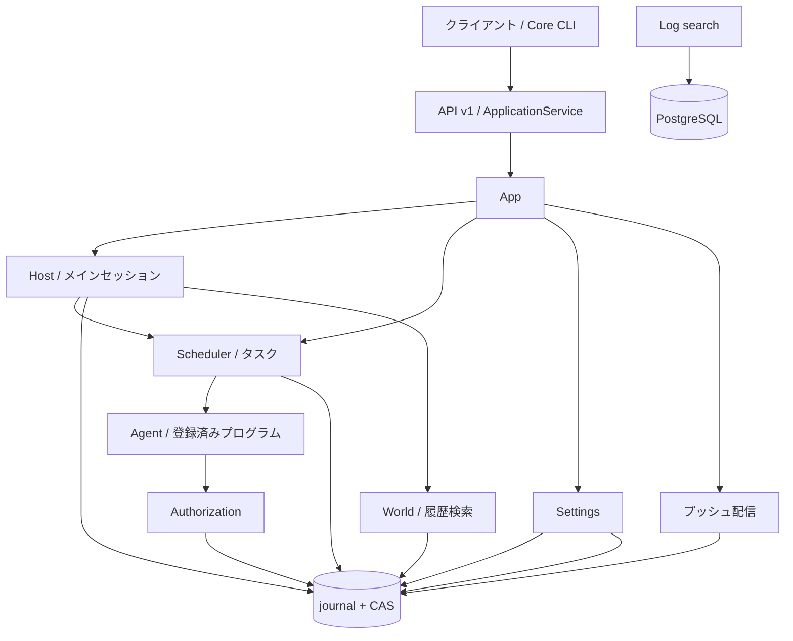

# アーキテクチャ

[English](../en/architecture.md) | [日本語](architecture.md) | [Français](../fr/architecture.md) | [中文](../architecture.md)

<!-- Generated by npm run docs:localize; edit docs/i18n/translations.json. -->

Secretary Core はローカルで動作する継続型パーソナルアシスタントサービスです。メインセッションはメモリ、タスク、Master とのやり取りをまとめ、Scheduler が実行を進めます。認可、永続化、復旧はホストコードが担います。クライアントは [API v1](api/v1/README.md) を通じて業務状態にアクセスします。

## モジュールと依存関係

ソースは `src/pi_secretary/src` にあります。[App.open / pump](../../src/pi_secretary/src/app.ts) が構成と処理推進の入り口です。

| モジュール | 役割 |
| --- | --- |
| [core-cli / core-client](../../src/pi_secretary/src/core-client.ts)、[backend](../../src/pi_secretary/src/backend.ts) | バックグラウンド Core の起動、検出、接続、停止 |
| [api-v1](../../src/pi_secretary/src/api-v1.ts)、[application-service](../../src/pi_secretary/src/application-service.ts) | HTTP 認証、コマンド受理、冪等性、公開 DTO。`api/` に契約と投影を保持 |
| [host](../../src/pi_secretary/src/host.ts)、[main-loop](../../src/pi_secretary/src/main-loop.ts)、[main-tools](../../src/pi_secretary/src/main-tools.ts) | メインセッションの依存関係、入力バッチ、ツール、復旧。context-assembly と memory-* がコンテキストとメモリを担当 |
| [scheduler](../../src/pi_secretary/src/scheduler.ts)、[task-planning](../../src/pi_secretary/src/task-planning.ts)、[task-triggers](../../src/pi_secretary/src/task-triggers.ts) | タスク提案、継続、期限到来処理、前提条件、実行スロット |
| [execution-runner](../../src/pi_secretary/src/execution-runner.ts)、[executor-tools](../../src/pi_secretary/src/executor-tools.ts)、[effects](../../src/pi_secretary/src/effects.ts) | 実行モデル、ファイル・プロセスへの作用、結果。execution-recovery と retention が復旧とアーカイブを担当 |
| [authorization](../../src/pi_secretary/src/authorization.ts)、[scopes](../../src/pi_secretary/src/scopes.ts) | 操作の許可、永続ルール、作用の判定、作業ルート、ディレクトリの占有 |
| [settings](../../src/pi_secretary/src/settings.ts)、[world](../../src/pi_secretary/src/world.ts) | Settings activation; Store-backed World facts and independent PostgreSQL log search |
| [sync-service](../../src/pi_secretary/src/sync-service.ts)、[notification-service](../../src/pi_secretary/src/notification-service.ts)、[push-service](../../src/pi_secretary/src/push-service.ts) | 差分変更、表示・既読管理、独立したプッシュ配信。wakeups が時刻指定入力を担当 |
| [transport](../../src/pi_secretary/src/transport.ts)、[store](../../src/pi_secretary/src/store.ts) | モデルのリクエスト・応答を保存し、業務状態とオブジェクト参照をコミット |

Pi Agent とモデルアダプターの依存バージョンは固定しています。出典は [UPSTREAM.json](../../src/UPSTREAM.json) を参照してください。公開 API の schema と内部永続化 schema は別々に管理します。生成ファイル、テスト、過去の資料は[ドキュメント一覧](README.md)から参照できます。

## プロセスと並行処理

各データディレクトリはロックを保持する単一の Core writer が管理し、メインセッションを一つ保持します。Host は入力バッチを直列処理します。Scheduler の実行者数はデフォルトで 2、`SECRETARY_MAX_WORKERS` で変更できます。同じ DIRECTORY Scope では、バインドされたルートを直列に占有します。NONE または Scope 未選択のタスクは、それぞれの `workspaces/<task_id>/work` を使用します。

Core は Store を開き、アップグレード条件と識別情報を確認してから World genesis を取り込みまたは初期化し、Authorization/Scheduler を復旧して Host/Settings を構築します。続いて独立したログ検索スキーマと読み取り索引を初期化します。API は 300 ms ごとに pump を呼び、通知、検索、World、設定、タスク、フィードバック、起床と Main を進めます。各モジュールが実行中の処理を管理し、停止時にモデル、実行者、DB 接続と writer を閉じます。

[process-control](../../src/pi_secretary/src/process-control.ts) は Python wrapper 経由で shell/program を起動します。まずプロセス識別情報を報告し、それが永続化されてから開始フレームを受け取ります。作用の結果とプロセス停止は別々に保存します。bash はバインドされたディレクトリでローカルユーザー権限により動作します。ファイルの read/write と成果物の読み取りはルート内のパスを検証します。登録済みプログラムではエントリーポイントの revision と SHA-256 を確認し、stdin/stdout で ProgramInvocation/ProgramResult を交換します。

## データとコミット

`record_type + id` がレコードを識別し、revision が更新を制御します。ObjectRef は SHA-256、バイト数、メディア型で原本を参照します。Session/Input はメインセッション入力、TaskPlan/Execution/TaskResult は各タスクの実行回、Consciousness/MemoryExtractionJob はワーキングメモリと出典、Operation は一つの外部作用を保存します。フィールドは[生成リファレンス](data/README.md)を参照してください。

Store は最初に CAS オブジェクトを書き込み、ハッシュチェーン付きの journal トランザクションを検証・追記します。fsync ACK を受け取ってからメモリ上の状態とインデックスに反映します。worker は匿名パイプでロックを保持する Python helper に接続し、リクエスト ID、sequence、digest によって追記確認を対応付けます。コミットとリプレイでは参照先ファイルと長さを確認し、本文の読み取り時には完全なハッシュを検証します。新しい Context は順序付きメッセージ参照マニフェストを使用し、`Store.read` はこれと旧メッセージ配列の両方に対応します。

[状態カタログ](../../src/state_machine/catalog.json) は Execution、Operation、Input、Authorization を定義します。Store はコミットと再生で最初の三つを検証し、Authorization はイベントで、他の記録は領域モジュールで進みます。World commits records, grants and results atomically to the journal; legacy SQL is imported read-only once. 検索、timeline、活動索引は正本から再構築できます。詳細：[システムの不変条件](invariants.md)。

## 現時点での制約

- Store は起動時に journal 全体をリプレイし、過去のフレームとログをメモリに常駐させます。スナップショットによる高速化と履歴回収は未実装です。
- Context はメッセージオブジェクトを共有しますが、モデルリクエストとプロバイダーの payload は完全なスナップショットを保持するため、長いループでは総保存量が二次的に増える可能性があります。
- shell/program はローカルユーザー権限で動作し、Scope がディレクトリのバインド、スケジューリング、ファイルツールの制約を提供します。

## データ保持と退役の境界

Execution の `retention_state=RETIRED` は終端の `state` と別であり、削除許可ではありません。[retention](../../src/pi_secretary/src/retention.ts) は実行終了、待機要求・不明な操作・未処理接続の不在、全 Feedback が `HANDLED`/`SUPPRESSED`、および `max(ended_at, last_activity_at)` から `retire_after_seconds`（作成時172800秒）の経過を要求します。イベントと結果詳細の CAS バイトを読み、ArchiveManifest と退役状態を保存しますが、journal・CAS・作業ディレクトリを削除しません。一覧・詳細・Task 閲覧では延長せず、明示的な `viewed` は退役前のみ期限をリセットします。退役後の詳細は識別情報と清単のみ、成果物は `archived` となり、接続の親にはできません（`PARENT_NOT_RESUMABLE`）。

バックアップと復元では Core ディレクトリ、対応する PostgreSQL、クライアントの草稿と復旧資料、外部 Scope の作業ルートを一緒に扱います。CAS の成果物スナップショットと現在の作業ファイルは別物で、相互に代替できません。異なる時点のデータベースと journal を組み合わせても完全な復元にはなりません。手順は[運用手順](operations.md#バックアップとアップグレード)、保持動作の回帰は[実行時テスト](../../test_case/offline/runtime/runtime.test.ts)を参照してください。

## Scope import transactions

Main-originated `scope.import` uses the same restricted `AUTHORIZED --journal_apply--> SUCCEEDED` transition as `world.change`, with a separate whole-frame guard. The Scope frame contains exactly the consumed grant, deterministic new Scope, Operation receipt and HOST-produced ENVIRONMENT Input. World frames retain their own guard and create no automatic result Input; external-effect operations cannot use this transition. Expiry and definite failure cancel without effect, and rejection/revocation notification reconciliation runs on startup and every pump.

ENVIRONMENT result Inputs are isolated at their original input-order position and have a read/query/report tool allowlist. They are excluded from Master quote/commitment extraction, kept as HOST notices in summaries and conversation history, and excluded from Master-input search. Scope status remains queryable through `scope_query`. No Task, Execution or Feedback is fabricated for the report.

Historical import replay checks the stored atomic bundle, deterministic IDs, grant transition and HOST provenance without regenerating notice text, current Scope content or CAS objects. Exact content and current filesystem checks remain live-commit admission rules. Directory identity uses device/inode: delete/recreate with inode reuse is not distinguishable by this check and is not an adversarial filesystem lock.

## Shared workspace projections

Omitted or null `scope_id` selects the built-in virtual Shared group; it never creates a Scope record. Explicit invalid, archived or unavailable Scopes fail. A named NONE Scope remains distinct. Shared and NONE use independent durable `<data/core>/workspaces/<task_id>/work` directories; task continuation retains these files, and completion/retirement never deletes them. Existing owner-managed DIRECTORY root changes still affect future executions, while historical Execution bindings remain immutable.

Task query/acceptance, API task/execution/result details and terminal Task details expose `scope_kind`, `scope_name` and `workspace_info` (absolute `path`, `root_kind`, `location=CORE_HOST`, `availability`, `reason`). An unbound path is `planned`, even if initialization has already created it; `verified` means the bound directory passed the current read-only filesystem check, not a permanent guarantee. Missing or unsafe bound roots are `unavailable` with a diagnostic reason. They are never recreated as empty historical recovery. Paths belong to the Core host, not a remote client. Artifact CAS delivery and remote `/open` restrictions are unchanged; a path display does not authorize another Task's files or provide an OS sandbox.
