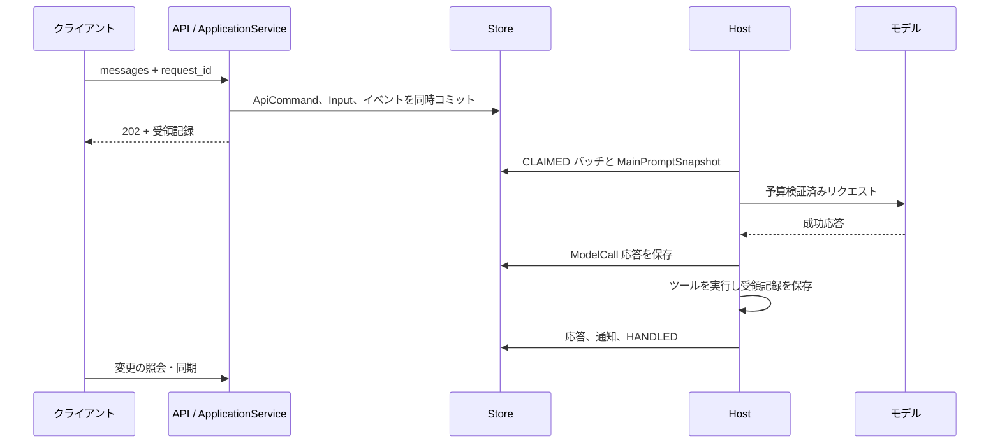
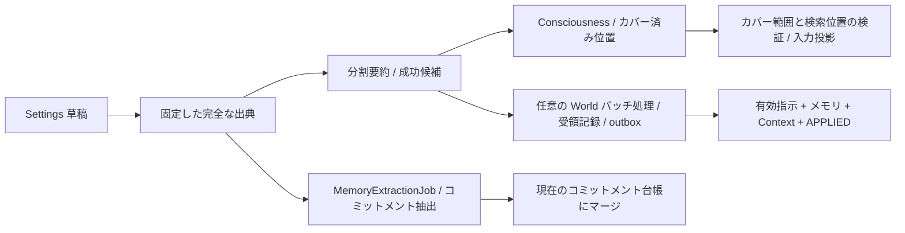
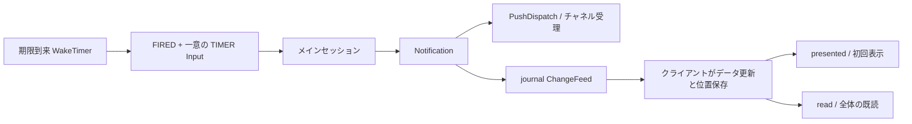

# データフロー

[English](../en/data-flow.md) | [日本語](data-flow.md) | [Français](../fr/data-flow.md) | [中文](../data-flow.md)

<!-- Generated by npm run docs:localize; edit docs/i18n/translations.json. -->

## 入力から応答まで

[ApplicationService](../../src/pi_secretary/src/application-service.ts) は受理と最初の業務変更を一体化します。[メインループ](../../src/pi_secretary/src/main-loop.ts)は今回の指示、ツール、Scope のスナップショットを固定し、[durableStream](../../src/pi_secretary/src/transport.ts) が成功応答を保存してから Agent にツール実行を渡します。復旧では保存済み成功応答とツール受領記録を再利用し、一時プレビューは call_id で最終メッセージに対応付けます。`MasterInteract` は通知を作成し、通常の最終応答と通知はそれぞれ履歴に残します。

## タスクの提案から結果まで

```mermaid
flowchart LR
  Proposal[task_propose] --> Plan[TaskPlan / 待機リクエスト]
  Plan --> Due[期限到来と前提条件]
  Due --> Execution[Execution / 固定した提案と作業ルート]
  Execution --> Slot[実行スロットを取得]
  Slot --> Tool[Agent ツール / 登録済みプログラム]
  Tool --> Auth[Operation 準備 / ルール照合または承認]
  Auth --> Effect[ディスパッチと作用の保存]
  Effect --> Result[submit_result / TaskResult / CAS 成果物]
  Effect --> Unknown[RESULT_UNKNOWN / 検証または判定]
  Unknown --> Result
  Result --> Feedback[Feedback / メインセッション入力]
```

[task-planning](../../src/pi_secretary/src/task-planning.ts) は完全な目標、制約、受け入れ条件、資料を保存し、[task-triggers](../../src/pi_secretary/src/task-triggers.ts) は IMMEDIATE、AT、INTERVAL に対応します。[実行ツール](../../src/pi_secretary/src/executor-tools.ts)は read、write、bash、request_decision、submit_result で、承認や作業上の回答を待つ間は停止します。write はバインドしたルート内でデフォルト許可し、DIRECTORY は `default_write=ask` に設定できます。単純な読み取り専用コマンドは [shell-policy](../../src/pi_secretary/src/shell-policy.ts) が固定 argv に変換し、その他の shell は認可を通します。「承認して記憶」は認可とルールを一つのトランザクションで保存し、実行直前にルールとリソースを再確認します。

`reuse_task_id + parent_execution_id` は同じタスクに即時の継続実行を作成します。parent は最新・終了済み・未アーカイブの実行でなければなりません。goal は今回の完全な目標です。省略・null の制約、受け入れ条件、期限、実行者は継承し、明示的な配列は元の項目を置き換えます。Scope はタスクから引き継ぎ、継続には at/interval を付けません。新しい Execution は提案とその時点の作業ルートを固定し、旧記録を残します。項目別評価は実行者が `verified_by=NOT_VERIFIED` として提出し、成果物は固定 CAS バージョンで保存します。HOT の保持期間はデフォルト 48 時間で viewed により延長でき、条件を満たすと [retention](../../src/pi_secretary/src/retention.ts) がアーカイブします。

## メモリの保守と設定

[メモリ保守](../../src/pi_secretary/src/memory-maintenance.ts)は要約と抽出進捗を独立してコミットし、失敗した分割を保存済み試行回数に従って再試行します。[Settings](../../src/pi_secretary/src/settings.ts) は草稿と出典を固定し、メインセッションと新規タスク取得を一時停止します。要約と容量確認を終えてから World バッチをコミットして受領記録を橋渡しし、最後にローカル設定をアトミックに切り替えます。指示のみの変更は Context を直接再構築します。この間も新規入力はキューに入り、実行中タスクは完了できます。COMMITTING/REBUILDING で再起動した場合は DB 受領記録と照合します。FAILED の手動バッチは草稿に戻せ、BLOCKED はコミット済み結果の照会を続けます。入力の除外と出典ルールは[メモリとプロンプト](memory-and-prompts.md)を参照してください。

## 同期、リマインダー、通知

[wakeups](../../src/pi_secretary/src/wakeups.ts) は pump で期限到来タイマーを配信し、停止中に期限が来たものは起動後に補います。TIMER は出典と遅延時間を保持し、通知するかはメインセッションが判断します。[SyncService](../../src/pi_secretary/src/sync-service.ts) は journal トランザクションに対応する永続カーソルを提供します。クライアントは処理済み位置を取得し、リソースを読み込み、変更を追跡して SSE に接続します。record 更新と invalidate による再取得で集約ビューを維持します。[通知サービス](../../src/pi_secretary/src/notification-service.ts)はクライアントごとの初回表示と全体の初回既読を別々に保存し、[プッシュ worker](../../src/pi_secretary/src/push-service.ts) は配信、通知を控える時間帯、再試行を独立して処理します。クライアントプロトコルは [API v1](api/v1/README.md) を参照してください。

## 現時点での制約

- 時刻指定のウェイクアップには Core の稼働が必要で、システムのスリープ中に期限が来たものは復帰後に配信します。
- プッシュは回数制限付きで再試行し、重複配信の可能性があります。チャネル受理とクライアント表示は別々に記録します。
