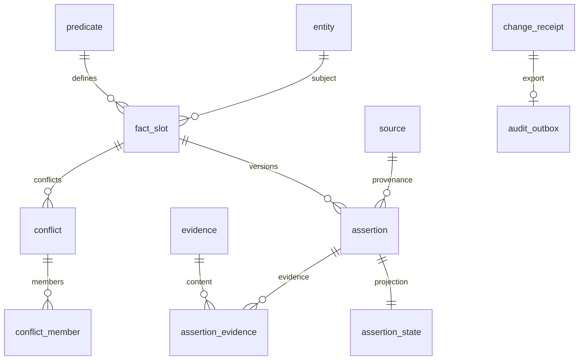

# PostgreSQL schema

[English](../en/database.md) | [日本語](database.md) | [Français](../fr/database.md) | [中文](../database.md)

<!-- Generated by npm run docs:localize; edit docs/i18n/translations.json. -->

World Model の正本となる事実は `wm` schema、再構築可能な履歴本文インデックスは `mem` schema を使います。Session、Task、認可ルール、Context、Consciousness は PostgreSQL テーブルではなくローカル journal に保存します。

正本の SQL：[001_world_model.sql](../../src/schema/001_world_model.sql)、[002_predicates.sql](../../src/schema/002_predicates.sql)、[003_settings.sql](../../src/schema/003_settings.sql)、[004_memory_search.sql](../../src/schema/004_memory_search.sql)、[queries.sql](../../src/schema/queries.sql)。実行リポジトリ：[world.ts](../../src/pi_secretary/src/world.ts)。

## マイグレーションとトランザクション

World.migrate は advisory lock でマイグレーションを直列化します。schema_version がなければ基準を適用し、predicate seed とバージョン 2、settings_batch_receipt のバージョン 3、mem/aliases のバージョン 4 の順に適用します。基準と seed は独自のトランザクションを持ち、失敗時は migrate が rollback してロックを解放します。owner が明示的に POST /api/v1/admin/world/migrate を呼び、受領記録で確認します。Core CLI は --migrate を処理しません。

変更は Settings コーディネーターで先に要約と context の事前確認を行います。認証済み local-owner の Settings API は明示的な適用証跡を記録し、モデル提案は引き続き認可が必要です。DB トランザクションはエンティティ、predicate、slot revision を確認し、バッチ全体と settings_batch_receipt をアトミックにコミットします。change_id/request_id/request_hash で重複排除と競合を確認します。assertion、状態投影、競合、証拠、change_receipt、audit_outbox を同時にコミットし、JSONL 監査出力は独立した復旧可能な橋渡しです。

## 関係図



## テーブルのフィールドと制約

以下は現在の SQL から直接生成した定義で、デフォルト値、外部キー、CHECK、UNIQUE、遅延制約を含みます。

### wm.schema_version

```sql
version integer PRIMARY KEY CHECK (version > 0),
    installed_at timestamptz NOT NULL DEFAULT now()
```

### wm.entity

```sql
entity_id uuid PRIMARY KEY,
    kind text NOT NULL CHECK (kind IN ('PERSON','ORGANIZATION','PROJECT','DEVICE','SERVICE','RESOURCE','GOAL')),
    display_name text NOT NULL CHECK (length(display_name)>0),
    external_key text UNIQUE,
    revision bigint NOT NULL DEFAULT 1 CHECK (revision>0),
    retired_at timestamptz,
    created_at timestamptz NOT NULL DEFAULT now(),
    updated_at timestamptz NOT NULL DEFAULT now()
```

### wm.source

```sql
source_id uuid PRIMARY KEY,
    kind text NOT NULL CHECK (kind IN ('MASTER','OBSERVATION','TASK_REPORT','MODEL_INFERENCE')),
    source_key text NOT NULL UNIQUE,
    description text NOT NULL,
    retired_at timestamptz
```

### wm.predicate

```sql
predicate_key text PRIMARY KEY CHECK (predicate_key ~ '^[a-z][a-z0-9_.]+$'),
    description text NOT NULL,
    subject_kinds text[] NOT NULL CHECK (cardinality(subject_kinds)>0),
    value_type text NOT NULL CHECK (value_type IN ('STRING','NUMBER','BOOLEAN','OBJECT','ARRAY','ENTITY')),
    cardinality text NOT NULL CHECK (cardinality IN ('SINGLE','MULTI')),
    unit text,
    value_schema jsonb NOT NULL CHECK (jsonb_typeof(value_schema)='object'),
    definition_revision bigint NOT NULL DEFAULT 1 CHECK (definition_revision>0)
```

### wm.fact_slot

```sql
slot_id uuid PRIMARY KEY,
    subject_id uuid NOT NULL REFERENCES wm.entity(entity_id),
    predicate_key text NOT NULL REFERENCES wm.predicate(predicate_key),
    scope_key text NOT NULL DEFAULT '',
    revision bigint NOT NULL DEFAULT 0 CHECK (revision>=0),
    UNIQUE(subject_id,predicate_key,scope_key)
```

### wm.change_receipt

```sql
change_id uuid PRIMARY KEY,
    request_id uuid NOT NULL UNIQUE,
    request_hash text NOT NULL CHECK (request_hash ~ '^[0-9a-f]{64}$'),
    outcome text NOT NULL CHECK (outcome IN ('APPLIED','CONFLICT','REJECTED')),
    result jsonb NOT NULL CHECK (jsonb_typeof(result)='object'),
    committed_at timestamptz NOT NULL DEFAULT now()
```

### wm.assertion

```sql
assertion_id uuid PRIMARY KEY,
    slot_id uuid NOT NULL REFERENCES wm.fact_slot(slot_id),
    slot_revision bigint NOT NULL CHECK (slot_revision>0),
    source_id uuid NOT NULL REFERENCES wm.source(source_id),
    change_id uuid NOT NULL REFERENCES wm.change_receipt(change_id) DEFERRABLE INITIALLY DEFERRED,
    value jsonb,
    object_entity_id uuid REFERENCES wm.entity(entity_id),
    epistemic text NOT NULL CHECK (epistemic IN ('OBSERVED','REPORTED','INFERRED','UNRESOLVED')),
    observed_at timestamptz,
    received_at timestamptz NOT NULL,
    valid_from timestamptz NOT NULL,
    valid_to timestamptz,
    fresh_until timestamptz,
    scope_description text NOT NULL CHECK (length(scope_description)>0),
    replaces_assertion_id uuid,
    UNIQUE(assertion_id,slot_id),
    UNIQUE(slot_id,slot_revision),
    FOREIGN KEY(replaces_assertion_id,slot_id) REFERENCES wm.assertion(assertion_id,slot_id),
    CHECK ((value IS NOT NULL AND value <> 'null'::jsonb AND object_entity_id IS NULL)
        OR (value IS NULL AND object_entity_id IS NOT NULL)),
    CHECK (valid_to IS NULL OR valid_to>valid_from),
    CHECK (fresh_until IS NULL OR fresh_until>=valid_from),
    CHECK (epistemic<>'OBSERVED' OR observed_at IS NOT NULL),
    CHECK (replaces_assertion_id IS NULL OR replaces_assertion_id<>assertion_id)
```

### wm.assertion_state

```sql
assertion_id uuid PRIMARY KEY,
    slot_id uuid NOT NULL,
    status text NOT NULL CHECK (status IN ('ACTIVE','SUPPORTING','CONTESTED','RETRACTED','SUPERSEDED')),
    revision bigint NOT NULL DEFAULT 1 CHECK (revision>0),
    changed_by uuid NOT NULL REFERENCES wm.change_receipt(change_id) DEFERRABLE INITIALLY DEFERRED,
    changed_at timestamptz NOT NULL DEFAULT now(),
    FOREIGN KEY(assertion_id,slot_id) REFERENCES wm.assertion(assertion_id,slot_id)
```

### wm.evidence

```sql
evidence_id uuid PRIMARY KEY,
    log_event_id uuid NOT NULL,
    object_path text NOT NULL CHECK (object_path !~ '(^/|(^|/)\.\.(/|$))'),
    sha256 text NOT NULL CHECK (sha256 ~ '^[0-9a-f]{64}$'),
    media_type text NOT NULL,
    byte_count bigint NOT NULL CHECK (byte_count>=0),
    UNIQUE(log_event_id,sha256)
```

### wm.assertion_evidence

```sql
assertion_id uuid NOT NULL REFERENCES wm.assertion(assertion_id),
    evidence_id uuid NOT NULL REFERENCES wm.evidence(evidence_id),
    PRIMARY KEY(assertion_id,evidence_id)
```

### wm.conflict

```sql
conflict_id uuid PRIMARY KEY,
    slot_id uuid NOT NULL REFERENCES wm.fact_slot(slot_id),
    status text NOT NULL CHECK (status IN ('OPEN','RESOLVED')),
    opened_by uuid NOT NULL REFERENCES wm.change_receipt(change_id) DEFERRABLE INITIALLY DEFERRED,
    resolved_by uuid REFERENCES wm.change_receipt(change_id) DEFERRABLE INITIALLY DEFERRED,
    resolution_note text,
    UNIQUE(conflict_id,slot_id),
    CHECK ((status='OPEN' AND resolved_by IS NULL AND resolution_note IS NULL)
       OR (status='RESOLVED' AND resolved_by IS NOT NULL AND resolution_note IS NOT NULL AND length(resolution_note)>0))
```

### wm.conflict_member

```sql
conflict_id uuid NOT NULL,
    slot_id uuid NOT NULL,
    assertion_id uuid NOT NULL,
    PRIMARY KEY(conflict_id,assertion_id),
    FOREIGN KEY(conflict_id,slot_id) REFERENCES wm.conflict(conflict_id,slot_id),
    FOREIGN KEY(assertion_id,slot_id) REFERENCES wm.assertion(assertion_id,slot_id)
```

### wm.audit_outbox

```sql
event_id uuid PRIMARY KEY,
    change_id uuid NOT NULL UNIQUE REFERENCES wm.change_receipt(change_id),
    payload jsonb NOT NULL CHECK (jsonb_typeof(payload)='object'),
    created_at timestamptz NOT NULL DEFAULT now(),
    exported_journal_txn uuid,
    exported_at timestamptz,
    CHECK ((exported_journal_txn IS NULL)=(exported_at IS NULL))
```

### wm.settings_batch_receipt

```sql
application_id uuid PRIMARY KEY,
    request_hash text NOT NULL,
    result jsonb NOT NULL,
    committed_at timestamptz NOT NULL DEFAULT now()
```

### mem.document

```sql
source_id text NOT NULL,
    event_id uuid NOT NULL,
    log_sequence bigint NOT NULL,
    occurred_at timestamptz NOT NULL,
    kind text NOT NULL CHECK (kind IN ('input','reply','task','notification')),
    session_id uuid,
    scope_id uuid,
    task_id uuid,
    body_hash text NOT NULL,
    PRIMARY KEY (source_id,event_id)
```

### mem.chunk

```sql
source_id text NOT NULL,
    event_id uuid NOT NULL,
    chunk_index integer NOT NULL,
    body_offset integer NOT NULL,
    body text NOT NULL,
    PRIMARY KEY (source_id,event_id,chunk_index),
    FOREIGN KEY (source_id,event_id) REFERENCES mem.document ON DELETE CASCADE
```

### mem.checkpoint

```sql
singleton boolean PRIMARY KEY DEFAULT true CHECK (singleton),
    source_id text NOT NULL,
    policy_version integer NOT NULL,
    journal_sequence bigint NOT NULL,
    journal_digest text NOT NULL,
    document_count bigint NOT NULL,
    chunk_count bigint NOT NULL
```

## インデックス、トリガー、読み取りモデル

assertion_state の部分一意インデックスで slot ごとに ACTIVE を最大一つ、conflict は OPEN を最大一つにします。出典・slot 時刻のインデックスが事実の読み取りを支え、pending_audit_exports は未出力イベントの走査を支えます。

validate_slot は subject kind と SINGLE/MULTI の scope_key、validate_assertion は slot revision、値型、ENTITY 参照を確認します。assertion、receipt、evidence、証拠関連は更新・削除不可、source 識別フィールドは不変、遅延トリガーは各 assertion の証拠を必須とします。訂正・撤回は新たな変更と投影で表し、settings_batch_receipt もバッチ冪等性のため更新・削除を禁止します。

World リポジトリは Ajv で predicate.value_schema を検証し、証拠オブジェクトと CAS を確認します。queries.sql は現在の投影、競合、出典、有効性の情報を返します。

## predicate の初期カタログ

初期の 10 項目は person.display_name、person.height、person.contact、person.member_of、preference.statement、goal.statement、project.constraint、resource.location、resource.depends_on、resource.observed_state です。型、基数、単位、JSON 値の制約は 002_predicates.sql を正本とします。これらの predicate は World に登録できる事実の型を表します。

## データベース設定

World は専用 DB を使い、接続ロールとバックアップはデプロイ環境で設定します。DDL は PUBLIC 権限を取り消し、Core の owner 認可はアプリケーション層で処理します。

## 履歴検索と別名

バージョン 4 は pg_trgm を導入し、wm.entity.aliases（非 null の text[]、デフォルト空配列）と mem.document、mem.chunk、mem.checkpoint を作成します。別名は認可された Settings/WorldCatalogChange で管理し、旧 ENTITY 編集で省略した場合は既存別名を保持します。名前や別名に複数一致がある場合は候補を返します。

検索投影は journal トランザクションフレームから上限付きで進み、全文を Unicode 境界で分割し、本文と処理済み位置を同時にコミットします。位置は出典、ポリシーバージョン、journal digest に結び付き、再起動時に出典不一致やデータ欠落があれば再構築します。インデックス再構築は wm の正本事実に影響しません。

本文は GIN pg_trgm とパラメーター化したリテラル ILIKE を使います。結果はイベント単位で重複排除し、時刻降順と安定したイベントキーで返します。時刻範囲は [from,to) で、フィルターを組み合わせます。SQL は 5 秒で search_timeout になります。trigram 抽出は locale に依存し、中国語のヒットと性能は実際の locale で個別に検証します。2 文字パターンは走査に退化する可能性があります。

デプロイ時の受け入れ検証では server_version、datctype、datcollate、datlocprovider、datlocale、datcollversion を読み取り専用で確認します。設定が異なる場合は一致する隔離 DB で中国語検証を繰り返します。実データのインスタンスはテストに使いません。原文は journal/CAS から分割して読み、mem は再構築可能です。
